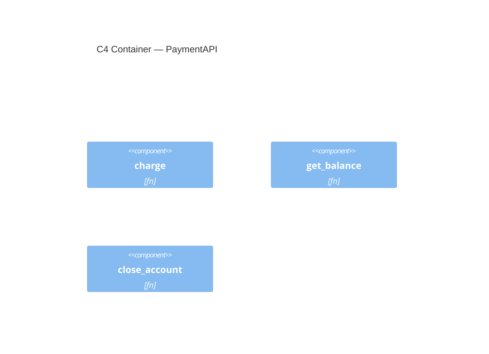
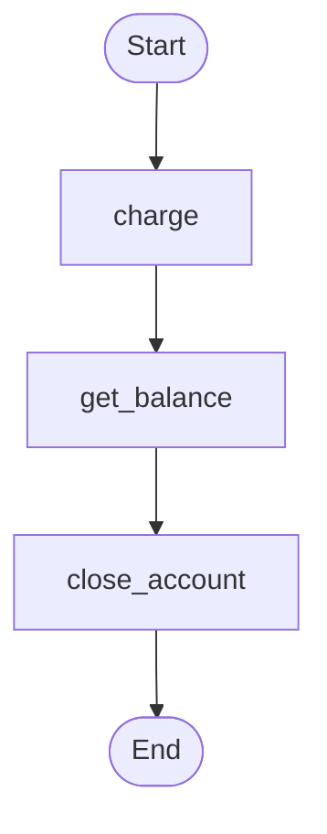
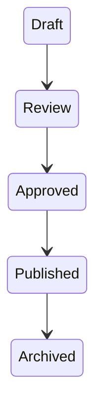

# Loom Language and Compiler Specification (clean-room edition)

This document is the narrative half of the clean spec for the ALX-R independent-derivation
experiment. Its companion `loom.loom` states the public API and AST in Loom syntax. Together they are
meant to be sufficient for a stateless reader to re-implement the compiler's **public API**:
`compile*` entry points, `parse`, the lexer, the AST shapes, `LoomError` and its wording, the checker
pipeline (rules and order), the emitted text of each target, the CLI and the project manifest.

Method: everything here was derived from (a) the public API surface in `src/lib.rs` and the
non-test code of `src/`, and (b) observation of the real `loom` binary on programs written for this
document and on `examples/` and `corpus/`. No test file or test oracle was consulted (see
`PROVENANCE.md`). Where behaviour looks accidental it is recorded anyway under "Quirks", because a
faithful re-implementation must reproduce it. Statements marked **(observed)** were confirmed by
running the binary; **(read)** means read from the compiler source but not probed.

Precedence of sources inside this document: the appendices "Observed input/output pairs" are
verbatim binary output and win over any prose summary.

---

## 1. Pipeline and public API

All entry points take `&str` source and return `Result<String, Vec<LoomError>>` unless stated.

| Function | Stages (in order) | Returns |
|---|---|---|
| `lexer::Lexer::tokenize(src)` | lex | `Result<Vec<(Token, Span)>, Vec<LoomError>>` |
| `parse(src)` | lex, parse | `Result<ast::Module, Vec<LoomError>>` |
| `compile(src)` | lex, parse, **checker pipeline** (section 8.3), SMT stage, Rust emit | Rust source |
| `compile_runtime(src)` | lex, parse, checker pipeline (no SMT stage), runtime emit | runtime scaffold |
| `compile_typescript(src)` | lex, parse, InferenceEngine, AspectChecker, TypeChecker, ExhaustivenessChecker, EffectChecker, AlgebraicChecker, UnitsChecker, TS emit | TypeScript |
| `compile_openapi(src)` | lex, parse, TypeChecker, AlgebraicChecker, OpenAPI emit | OpenAPI 3.0.3 JSON text |
| `compile_json_schema(src)` | lex, parse, TypeChecker, JSON-Schema emit | JSON text |
| `compile_wasm(src)` | lex, parse, InferenceEngine, TypeChecker, ExhaustivenessChecker, WASM emit | WAT text |
| `compile_simulation(src)` | lex, parse, TypeChecker, teleos check, simulation emit | Python (Mesa) |
| `compile_neuroml(src)` | lex, parse, TypeChecker, NeuroML emit | XML |
| `compile_mermaid_c4/sequence/state/flow(src)` | lex, parse only (NO checkers) | `Result<String, String>` (error = the Display strings of lex errors joined by `"; "`, or the single parse error) |

Rules common to all:

* The lexer reports **all** lexical errors (one `LexError` per offending character run); if any, nothing else runs.
* The parser stops at the **first** error and returns a one-element vector.
* Checker stages run strictly in the order given. A stage that returns any errors aborts the whole
  pipeline: those errors (all of that stage, in the stage's own order) are the result. Later stages
  are not run. (observed: a program that violates both the refinement rule and the teleos rule only
  reports the refinement error.)
* Parsing consumes exactly one `module ... end`. **Tokens after the closing `end` are not parsed or
  checked** but they ARE lexed, so a lexically invalid character after the module still fails.
  (observed)
* Mermaid emitters skip all checkers, so ill-typed programs still produce diagrams.
* `compile_wasm`, unlike `compile`, ignores `require:`/`ensure:` entirely.

### 1.1 Checker stage kinds

A stage wraps one checker plus a list of suppressed substrings. After the checker runs, every error
whose `Display` text *contains* any suppressed substring is dropped; if nothing remains the stage
passes. Kinds used by `compile`:

* **hard** - suppress nothing.
* **warn_only** - suppress `"[warn]"`.
* **suppressing(list)** - the listed substrings (see 8.3).

Checkers prefix advisory messages with `[warn]`, `[hint]`, `[info]`, `[error]`. Only messages
that are not suppressed become failures.

### 1.2 SMT stage (end of `compile`)

After all checkers pass: for every `fn` that has `require:` or `ensure:`, a purely structural check
looks at simple comparisons `var OP number` (or `number OP var`, operator flipped) joined by `and`
across ALL requires and ensures of that fn, ignoring variable `result`. It keeps, per variable,
the tightest lower and upper bound (strict or not). If the interval is empty it yields one error of kind
`ParseError` with span `0..0` and text:

    fn 'f': SMT counterexample found — spec is contradictory: contract constraints on 'x' are unsatisfiable (lower bound 5, upper bound 3)

(observed: `require: x > 5`, `ensure: x < 3`.) Numbers print with Rust `{}` formatting of f64
(`5`, `3`, `2.5`). If a `z3` binary exists the real SMT call would also be made, but the result
is never an error unless the structural check fires. When `z3` is absent, the first such attempt prints
two lines once per process to **stderr**: `loom: SMT verification skipped — z3 binary not found on PATH.`
and `      Install Z3 to enable formal require:/ensure: contract checking.` These lines are not errors.

---

## 2. Lexical structure

Input is UTF-8. Tokenisation is longest-match; keywords beat identifiers.

* Whitespace (space, tab, CR, LF, FF) is skipped.
* Line comment: `--` to end of line. Block comment: `{- ... -}` (non-nested).
* `Ident`: `[A-Za-z_][A-Za-z0-9_']*`.
* `IntLit`: `[0-9]+` (i64). `FloatLit`: `[0-9]+\.[0-9]+([eE][+-]?[0-9]+)?` (f64). There is no negative literal:
  `-x` is an operator (3.3). `BoolLit`: `true`, `false`.
* `StrLit`: `"..."` where the content is any run of non-`"` characters; **no escape processing**; token text is the
  content without quotes.
* `InlineBlock`: the word `inline` followed by optional whitespace and `{`; the token payload is the raw text up to the
  matching `}` (nested braces counted, braces inside Rust strings are *not* special). An unmatched brace is a lex error.
* Punctuation/operators: `::` `->` `|>` `!=` `>=` `<=` (two-char, longest first); `|` `=` `==` `+` `-` `*` `/`
  `:` `,` `.` `[` `]` `(` `)` `{` `}` `<` `>` `~` `?` `@`.
* `and` / `&&` are the same token; `or` / `||` the same; `not` / `!` the same.
* Lex error: any unmatched character yields `LexError` with message `unexpected character(s): "<text>"`
  (Rust `{:?}` of the slice, so a `$` prints `"$"`) and the span of that character. Several consecutive bad characters
  each produce their own error.
* A run of identifier/number characters (`[A-Za-z0-9_'.]`) longer than 4096 bytes is a single `LexError`
  `token longer than 4096 characters` with the span of the run.

Keywords (each becomes its own token; the parser lets many of them serve as names, see 3.8):
`module fn type enum let match with require ensure import spec provides requires effect where end of then if else and or not as for in
invariant test interface implements flow lifecycle being telos form matter regulate evolve toward search fitness bounds ecosystem members
signal from to payload autopoietic epigenetic modifies reverts_when morphogen threshold produces telomere on_exhaustion limit crispr
replace guide quorum action plasticity rewire trigger rule hebbian boltzmann modifiable_by bounded_by temporal always eventually never
precedes reaches transitions before separation owns disjoint frame proof gradual boundary blame distribution proposition termination
timing_safety functor monad law certificate aspect pointcut around after annotation degenerate fallback checkpoint canalize pathway
senescence adopt umwelt sense resonance store table node edge ttl index retention resolution format compression capacity eviction fact
dimension embedding mapreduce consumer offset partitions replication process session send recv duality handle operation manifest artifact
reflects usecase within actor acceptance journal scenario migration property forall shrink samples measured_by thresholds convergence
divergence propagation guides signal_attention prioritize attenuate telos_contribution messaging_primitive guarantees telos_function
entity intent_coordinator discipline chain states dag nodes edges const pipeline step saga compensate event command query circuit_breaker
retry rate_limiter cache bulkhead timeout observer pool scheduler queue lock channel semaphore barrier event_bus state_machine workflow
projection resource lease classifier provenance export seal`.
Not keywords (plain identifiers): `describe`, `domain`, `symbiotic`, `niche_construction`, `correctness_report`, `key`, `value`,
`kind`, `module` as a *name* is allowed in annotation keys only. `todo`, `result`, `self`, `default` are identifiers with special
meaning in later stages.

---

## 3. Concrete syntax

### 3.1 Module

```
module Name
[describe: "text"]
[domain: ident ident ...]
[@annotation ...]*
[import Name]*
[spec Name]
[implements Name]*
[provides { op :: sig [,] ... }]
[requires { name: Type [,] ... }]
  item*  
end
```

The header order above is mandatory; `provides` must precede `requires`. Inside the body, `import Name`,
`implements Name` and loose `@annotation` lines (accumulated onto the next `fn`) may also appear. Body items
are parsed in a loop until `end`; items are routed as follows:

* collected into dedicated `Module` vectors: `invariant`, `test`, `interface`, `lifecycle`, `temporal`, `being`, `ecosystem`, `flow`, `aspect`;
* everything else becomes an `Item` in `Module.items` in source order.

A module name may be any identifier or any keyword usable as a name. Domain labels after `domain:` continue while the next token is a
name-like token.

`describe:` must be exactly `Ident("describe") : StrLit`.

### 3.2 Annotations

`@name` or `@name(arg tokens)`. `name` may contain hyphens (`@never-log`, `@encrypt-at-rest`, `@exactly-once`): after the first
name token, each `- name` pair is joined into the key. A parenthesised argument is collected as a raw string: string literal
contents are unquoted, identifiers/keywords as text, `.` kept, nested parentheses kept, other tokens rendered with their source text, all
**concatenated with no separator** (`@foreign_key(Users.id)` -> value `Users.id`; `@since("v1.0")` -> `v1.0`). No argument -> value `""`.
Keywords are valid annotation names (`@never`, `@store` ...).

### 3.3 Functions

```
fn name[<A, B>] [describe: "..."] [@ann]* :: T1 -> T2 -> ... -> R
  [require: expr]*  [ensure: expr]*  [with Name]*
  [separation: ...] [gradual: ...] [distribution: ...] [process: ...] [timing_safety: ...]
  [termination: ident] [proof: ident]*   (these clause blocks may be interleaved, in any order)
  [degenerate: ...] [handle comp with ... end]
  body-expression*
end
```

* `name` may be any name token (`expect_any_name`); a keyword that has no textual mapping (for example `pipeline`) is rejected with
  `expected identifier, found PipelineKw`. (observed)
* Annotations placed before `fn` (own line `@x`) are merged into the fn's annotations *before* those after the name.
* The signature is curried: all types but the last are parameters, the last is the return type. Parameters have **no names**
  in source; the emitters invent them (section 9.3).
* The body is zero or more expressions up to `end`; the value of the fn is the last. A `describe: "..."` inside the body is allowed
  and ignored. A fn with no body but with contracts is legal.
* `with Name` collects dependency names (kept in order).
* `Effect<[E1, E2@tier], T>` in the return type: the `@tier` suffix (`pure|reversible|irreversible`, anything else = irreversible) is
  recorded in `FnDef.effect_tiers` as `(effect, tier)` in the order written; tiers are recorded **only for effects that carry @tier**.
* `inline { rust }` as a body expression is `Expr::InlineRust(text)`.

### 3.4 Type definitions

```
type Point =            enum Shape =                   type Email = String where expr
  x: Float                | Circle of Float            type Pos   = Int where self > 0 and self < 100
  y: Float @pii           | Empty                      type Names = List<String>         -- alias
end                     end
```

* After `type N =`: if the next token is a name followed by `where` -> `RefinedType`; if next is `end` or `name :` -> product type
  (fields, optional commas, field annotations may precede or follow the type, ends with `end`); otherwise a **type alias**
  `Item::TypeAlias(name, type, span)` with no `end`.
* A refined type may be followed by `on_violation: ident` and/or `repair_fn: ident` lines; if either is present, the refined type must be closed by `end`.
* Field names may be keywords from set (a) of section 3.8 (`queue`, `edges`, `action`, `limit` ...); other keywords (including `type` and `end`) are not accepted in `type ... end` field lists.
* Enum variants: `| Name` or `| Name of TypeExpr`. One payload type only (use a tuple type for several).
* `proposition N = Type [where expr]`, `functor N<P> [law: name]* end`, `monad N<P> [law: name]* end`, `certificate: field = value ... end`,
  `annotation name(p: T, ...)` with meta-annotations on preceding `@` lines, `correctness_report` blocks, `sense`, `adopt`, `pathway`, `symbiotic`,
  `niche_construction` exist and produce the corresponding `Item` variants (see loom.loom).

### 3.5 Type expressions

```
TypeExpr  ::= Name | Name<T, ...> | (T, T, ...) | () | [T] | ?
            | Effect<[Name[@tier], ...], T> | Option<T> | Result<T, E> | Tensor<rank, [dim, ...], unit>
```

* `()` is `Base("Unit")`; `(T)` is just `T`; `[T]` is `Generic("Vec", [T])`; `?` is `Dynamic`.
* `Option<T>` and `Result<T,E>` written in source become the dedicated `TypeExpr::Option` / `TypeExpr::Result` variants.
* `Float<usd>` is `Generic("Float", [Base("usd")])`; same for `Int<meters>`.
* `List<T>`, `Map<K,V>`, `Set<T>` are ordinary `Generic`.
* `Effect<[..], T>` -> `Effect(names, Box<T>)`; note it also appends tiers to the parser's pending list (3.3).
* `Tensor<rank, [shape...], unit>`: `rank` is an integer literal (otherwise parse error `expected integer literal for tensor rank`), shape entries are identifiers/integers kept as strings, `unit` a type expr.
* `TypeVar(u32)` is produced only by inference.

### 3.6 Expressions

Precedence from loosest to tightest (all binary operators are left-associative):

1. `let name = e [in body]` (also `let (a, b) = e`; the name string for a destructuring let is `"(a, b)"`), `match`, `for`
2. `|>` pipe
3. `or` / `||`
4. `and` / `&&`
5. comparison: `=` and `==` (both `Eq`), `!=`, `<`, `<=`, `>`, `>=`
6. `+` `-`
7. `*` `/`
8. prefix `not`/`!` and unary `-`
9. postfix: `.field` (also `.0` tuple index; keywords allowed as field names), call `f(args)`, index `e[i]`, record literal `Name { f: e, ... }`,
   `as Type`, `?` (try)
10. primary: literals, identifiers, `(e)`, `()` (= unit literal), tuple `(a, b)`, list literal `[a, b]` (**desugars to `Expr::Tuple`**), `inline { }`, lambda `|x, y: T| body`.

Desugarings (observed in the AST consumed by emitters):

* `not e` -> `BinOp(Eq, e, Literal(Bool(false)))`.
* `-e` -> `BinOp(Sub, Literal(Int(0)), e)`. Hence `-1.0` is `0 - 1.0`.
* `a == b` and `a = b` both -> `BinOp(Eq,..)`.
* A record literal is only recognised when the preceding expression is a plain identifier and record literals are not suppressed
  (they are suppressed while parsing the iterator of `for`).
* `for v in iter { body }` (braces) -> `ForIn`; `match subject | pat [if guard] -> body ... end`.
* `let` as a statement has `body: None`; the `in` form has `body: Some`.
* Call arguments and list elements are full expressions (so `let` and `match` may appear there).
* Keywords usable as identifiers in expression position: `process`, `query`, `command`, `capacity`, `fitness`.

### 3.7 Patterns

`Name(p, ...)` -> `Variant(Name, subs)`; a bare name starting with an uppercase letter -> `Variant(Name, [])`; any other lowercase name -> `Ident`;
`_` -> `Wildcard`; int, bool and string literals -> `Literal`. Anything else: `expected pattern, found <Token Debug>`.

### 3.8 Names that may be keywords

There are two "keyword may act as a name" sets.

(a) `expect_any_name` accepts an `Ident` or exactly these keywords (and nothing else): `threshold limit produces modifies reverts_when on_exhaustion signal payload from to toward bounds members
fitness telos form matter regulate evolve degenerate fallback checkpoint canalize pathway senescence store table node edge ttl index retention resolution format compression capacity eviction
fact dimension embedding edges step adopt process plasticity telomere retry rate_limiter cache bulkhead timeout observer pool scheduler queue lock channel semaphore action actor barrier
event_bus state_machine workflow projection resource lease`. It is used for: module names, fn names, product-type field names, record-literal field names, `.field` accesses, `with`
dependency names, `requires {}` dependency names, tuple-`let` binders, session role names, handle-block computation names. A keyword outside this set (for example `end`, `requires`, `states`,
`trigger`, `pipeline`, `type`) in those positions gives `expected identifier, found <Token>`. (observed: a product-type field named `requires` or `end` fails.)
Strictly `Ident` is required for: type names, enum names, variant names, plain `let` binders, lambda parameters, lifecycle states, and most `Name` positions in first-class items.

(b) `token_as_ident` (used for annotation names, inline `{ f: T }` field lists, store entries, `key: value` lines inside blocks, domain labels) accepts `Ident` plus a much broader keyword set: the set (a)
plus `never always before temporal eventually precedes reaches transitions separation owns disjoint frame proof aspect pointcut around after annotation gradual boundary blame distribution
proposition termination timing_safety functor monad law certificate toward sense resonance umwelt mapreduce consumer offset partitions replication session send recv duality handle operation
implements export seal provenance convergence divergence bounded_by measured_by thresholds telos_function entity intent_coordinator states chain dag nodes const pipeline saga compensate event
command query circuit_breaker threshold signal_attention guides requires module bounds type from` (so annotations such as `@never`, `@store`, `@type` and inline fields such as `{ type: T }` work).

### 3.9 Other module-level forms

```
invariant name :: expr                       test name :: expr          (NO own `end`: a test body is one expression; the next `end` closes the module)
interface Name  fn m :: sig ... end          lifecycle T :: S1 -> S2 -> S3        [checkpoint: name requires: x on_fail: y end ... end]
flow label :: TypeA, TypeB                   temporal Name  always: expr | eventually: T reaches S | never: S transitions to S | precedes: S before S  end
```

`lifecycle` without checkpoints has no `end`. With a `checkpoint:` it is closed by one extra `end`, and each checkpoint has its own `end`.

### 3.10 First-class items (all closed with `end`; unknown keys in the body are skipped)

Each item below yields an `Item` variant whose fields and defaults are listed in `loom.loom`; the Rust text emitted for each is in
Appendix B (observed). Syntax:

```
const Name: Type = literal
chain Name  states: [A, B, C]  transitions:  A -> B: 0.3 ... end  end
dag Name  nodes: [A, B]  edges: [A -> B, ...]  end
pipeline Name  step s :: In -> Out ... end
saga Name  step s :: In -> Out   compensate s :: In -> Out ... end
event Name  field: Type ... end              command Name  field: Type ... end       query Name  field: Type ... end
circuit_breaker Name  threshold: 5  timeout: 30  fallback: fn_name  end        (defaults 5 / 30 / "")
retry Name  max_attempts: 3  base_delay: 100  multiplier: 2  on: ErrorType  end (defaults 3 / 100 / 2 / "")
rate_limiter Name  requests: 100  per: 60  burst: 0  end
cache Name  key: T  value: T  ttl: 300  end                                     (String / String / 300)
bulkhead Name  max_concurrent: 10  queue_size: 0  end
timeout Name  duration: 30  unit: ms|s|min  end                                  (30 / "s")
fallback Name  value: "literal"  end                    observer Name  type: T  end    (String)
pool Name  size: 10  end        scheduler Name  interval: 1  unit: s  end         queue Name  capacity: 0  kind: fifo|lifo  end
lock Name end    channel Name  type: T  capacity: 0  end    semaphore Name  permits: 1  end    actor Name  type: T  end
barrier Name  count: 2  end     event_bus Name  element_type: T  end    state_machine Name  initial: State  end   ("Initial")
workflow Name end     projection Name  element_type: T  end     resource Name end    lease Name  ttl: 60  end
classifier Name  model: regex  retrain_trigger: "text"  end                                                  (model default "regex")
messaging_primitive Name  pattern: request_response|publish_subscribe|point_to_point|producer_consumer|bidirectional|stream
                          guarantees: @exactly-once @at_least_once ...   timeout: mandatory  end
telos_function Name  statement: "..."  bounded_by: id  measured_by: "..."|id  guides: [a, b]  thresholds: convergence: 0.8 divergence: 0.2 [warning: x] [propagation: x] end
entity Name<Node, Edge> [describe: "..."] [@ann]* [alias_of: Kind] [end]
intent_coordinator Name  telomere: 90.days  governance: automatic|ai_proposes|human_only|blocked  signals: [a,b]  rollback_on: "..."  min_confidence: 0.7  audit_path: "..."  end
discipline CQRS|EventSourcing|DependencyInjection|CircuitBreaker|Saga|UnitOfWork  for Target  [events: [..] | binds: [..] | steps: [..] | tables: [..] | max_attempts: N | retry_attempts: N]*  end
store Name :: Relational|KeyValue|Graph|Document|Columnar|Snowflake|Hypercube|TimeSeries|Vector|InMemory(Kind)|FlatFile|Distributed|DistributedLog
   table T <fields> end | node N :: { f: T } | edge E :: A -> B [{ f: T }] | key: T | value: T | event E :: { } | embedding :: { } | fact F :: { } | dimension D :: { }
   | schema S :: { } | mapreduce J  map: sig reduce: sig [combine: sig] end | consumer C :: offset: earliest  | ttl: 90days  retention: ...  etc.   end
session Name  role:  send: T  recv: T  end ...  duality: a <-> b  end
effect Name[<P>]  operation op :: In -> Out ... end                       (also inside fn: `handle comp with Eff.op(args) -> k: ... end end`)
aspect Name  pointcut: fn where @ann | fn where effect includes E   [and|or ...]   before: f  after: f  after_throwing: f  around: f  on_failure: f  max_attempts: N  order: N  end
usecase Name:  actor: X  precondition: p  trigger: t  postcondition: q  acceptance:  test name: free text ... end  end
property name: forall v: Type invariant: free-text-expr  [shrink: bool] [samples: N]  end
boundary ... (exports / private / sealed lists)
```

Free-text fields (property invariants, usecase text, scenario clauses) are kept as strings assembled from token source text joined by single spaces.
Property default `shrink: true`, `samples: 100`.

### 3.11 Beings and ecosystems

```
being Name
  [describe: "..."]  [@annotation]*  [autopoietic: true]
  matter:  field: Type ... end            -- list of FieldDef
  form:    type ... end  enum ... end end
  function: fn ... end end
  telos: "description"  [bounded_by: id]  [modifiable_by: id]  [measured_by: ...]  [thresholds ...]  end
  regulate var  target: id  bounds: (low, high)  [response: ...]  [telos_contribution: 0.5]  [trigger: ...] end
  evolve [Name]  toward: telos  search:  | gradient_descent when cond | simulated_annealing when cond ...  constraint: "text"  [rate: 0.01]  end
  epigenetic: signal: s  modifies: m  reverts_when: r end        morphogen: signal: s threshold: 0.8 produces: [A, B] end
  telomere: limit: 50  on_exhaustion: senescence end              crispr: target: t replace: r guide: g end
  plasticity: trigger: t  modifies: m  rule: hebbian|boltzmann|... end   rewire: trigger: drift_exceeds 0.35 candidates: [a,b] selection: fitness_guided end
  learn: gaussian_process|attention_model|neural_network  key: value ... end
  canalize / senescence / criticality / umwelt / resonance / manifest / migration / journal / scenario / boundary / memory / signal_attention / propagate / relates_to / role  ...
end
ecosystem Name  members: [A, B]  signal Name from A to B  payload: Type  end  quorum: signal: s threshold: 0.6 action: a end  telos: "..."  end
```

Search strategies: `gradient_descent, stochastic_gradient, simulated_annealing, derivative_free, mcmc, genetic, particle_swarm`. Annotations
on their own line inside a being (`@mortal @sandboxed @corrigible @transparent @bounded_telos`) are attached to the being; `autopoietic: true`
must come after annotation lines. The AST for all of these is in `loom.loom` (struct `BeingDef`). Block syntax details beyond this summary were read
from the parser but only the blocks used by `examples/` were probed.

---

## 4. AST shapes

Normative field-by-field definitions are in `loom.loom` (they mirror the Rust definitions: `pub struct`/`enum` with the stated field
names and types, deriving `Debug, Clone, PartialEq` except where noted). Key points a re-implementer must match:

* `Span { start: usize, end: usize }` byte offsets, `Span::new`, `Span::synthetic()` = `0..0`, `Span::merge(a, b)` = (min start, max end); `Display` is `"{start}..{end}"`.
  It derives `Debug, Clone, PartialEq, Eq, Hash`.
* `Module` has the fields listed in `loom.loom`; `Item` is a closed enum of 58 variants (listed in `loom.loom`).
* `FnDef.requires/ensures` are `Vec<Contract { expr: Expr, span }>`; `FnDef.body: Vec<Expr>`; `RefinedType.predicate: Expr`;
  `Invariant.condition: Expr`; `TestDef.body: Expr`.
* `FnTypeSignature { params: Vec<TypeExpr>, return_type: Box<TypeExpr> }`.
* `TypeDef` and `EnumDef` have **no** `type_params` field.
* `Annotation { key: String, value: String }` (no span).
* `Expr` has exactly the 16 variants listed in loom.loom; `Literal` = `Int(i64) | Float(f64) | Str(String) | Bool(bool) | Unit`;
  `BinOpKind` = `Add Sub Mul Div Eq Ne Lt Le Gt Ge And Or`; `Pattern` = `Variant(String, Vec<Pattern>) | Ident(String) | Wildcard | Literal(Literal)`.
* The spans of nodes are best-effort: a node's span is the merge of its first token's span and the span of the token *current when the node was
  finished* (usually the token after it). Do not rely on end offsets except for the module span, which ends at the closing `end`
  token. Observed CLI offsets, e.g. `type error at 24..52` for a type declaration, depend on this rule.

---

## 5. Diagnostics

### 5.1 `LoomError`

```
LexError{msg,span}  ParseError{msg,span}  TypeError{msg,span}  EffectError{msg,span}  CodegenError{msg,span}
NonExhaustiveMatch{missing: Vec<String>, span}  WasmUnsupported{feature, span}  UnificationError{msg,span}
UndeclaredDependency{name, span}
```

`Display` strings (exact):

| Variant | Display |
|---|---|
| LexError | `lex error at {span}: {msg}` |
| ParseError | `parse error at {span}: {msg}` |
| TypeError | `type error at {span}: {msg}` |
| EffectError | `effect error at {span}: {msg}` |
| CodegenError | `codegen error at {span}: {msg}` |
| NonExhaustiveMatch | `non-exhaustive match at {span}: missing variants: {missing joined by ", "}` |
| WasmUnsupported | `wasm unsupported at {span}: {feature}` |
| UnificationError | `type unification error at {span}: {msg}` |
| UndeclaredDependency | `undeclared dependency `{name}` at {span}: add it to the module's `requires` block` |

with `{span}` = `start..end`. `kind()` returns the variant name as a string (`"LexError"`, ... `"UndeclaredDependency"`);
`span()` returns the span; constructors `LoomError::lex/parse/type_err/effect(msg, span)`. `LoomError` is `Debug, Error, Clone, PartialEq`.

### 5.2 CLI rendering

Each error is printed to stderr as `{input path as given}:{span.start}:{span.end}: {kind}: {Display}` (so the span appears twice),
exit status 1. (observed)

```
a.loom:83:132: NonExhaustiveMatch: non-exhaustive match at 83..132: missing variants: Blue
```

### 5.3 Parser messages

* `expected {Token Debug}, found {Token Debug}` / `expected {Token Debug}, found end of input` (token names are Rust Debug of the lexer enum: `End`, `Colon`, `Ident("x")`,
  `StrLit("s")`, `IntLit(3)`, `PipelineKw`, ...).
* `expected identifier, found {Debug}` / `... found end of input`
* `unexpected token in expression: {Debug}` / `unexpected end of input in expression`
* `expected pattern, found {Debug}` / `expected pattern, found end of input`
* `expected type expression, found {Debug}` / `... found end of input`
* `unexpected token at item level: {Debug}` / `unexpected end of input inside module`
* `expected value, got {Debug of Option<&Token>}` (e.g. `Some(End)`)
* `expected temporal property (always, eventually, never, precedes), got {Debug of Option<&Token>}`
* `expected integer literal for tensor rank` (also `..., found end of input`), `expected string literal after telos:`, `expected bool after shrink:`,
  `expected int after samples:`, `expected distribution family name`, `expected operation name`, `expected dag name`, `expected constant name`,
  `expected type after ':'`, `expected literal value for const`, `unknown plasticity rule: expected hebbian, boltzmann, or reinforcement_learning`,
  `unexpected aspect clause `{x}``, `expected aspect clause, got {Debug}`, `expected `includes` after `effect` in pointcut`, `expected pointcut atom, got {Debug}`.

Examples (observed): `x +` followed by `end` -> `unexpected token in expression: End`; `$` -> lex error.

---

## 6. Semantic checks (order and wording)

### 6.1 Stage list of `compile` (exact order)

 1 InferenceEngine (hard)  2 AspectChecker  3 TypeChecker  4 RefinementChecker  5 ExhaustivenessChecker  6 EffectChecker  7 AlgebraicChecker
 8 UnitsChecker  9 TypestateChecker  10 TemporalChecker  11 SeparationChecker  12 GradualChecker  13 ProbabilisticChecker  14 DependentChecker
 15 SideChannelChecker  16 CategoryChecker  17 CurryHowardChecker  18 SelfCertChecker  19 TensorChecker  20 PrivacyChecker  21 Teleos  22 Safety
 23 SessionChecker  24 EffectHandlerChecker  25 Randomness  26 Stochastic  27 CanalizationChecker  28 SenescenceChecker  29 CriticalityChecker
 30 HgtChecker  31 NicheConstructionChecker  32 UmweltChecker  33 ResonanceChecker  34 PathwayChecker  35 SymbiosisChecker  36 ErrorCorrectionChecker
 37 DegeneracyChecker  38 CheckpointChecker  39 SemiosisChecker (all hard)
 40 StoreChecker (suppress `[hint]`,`[warn]`,`[info]`)  41 UseCaseChecker (warn_only)  42 ManifestChecker (warn_only)
 43 MigrationChecker (suppress `[warn]`,`[info]`)  44 MinimalChecker (suppress `[info]`)  45 JournalChecker (warn_only)  46 ScenarioChecker (warn_only)
 47 PropertyChecker (warn_only)  48 ProvenanceChecker (warn_only)  49 BoundaryChecker (warn_only)  50 EvolutionVectorChecker (suppress `[warn]` and `""`,
 i.e. effectively everything: an empty substring matches every message)  51 CognitiveMemoryChecker (warn_only)  52 SignalAttentionChecker (hard)
 53 MessagingChecker (warn_only)  54 EntityChecker (hard).  Then the SMT stage (1.2).

Consequence: messages starting `[error] ...` from warn_only checkers (boundary, provenance, migration) DO fail the build, since only `[warn]`
is suppressed.

### 6.2 Rules and messages (each message is the `msg` text; errors are `TypeError` unless noted)

**InferenceEngine** (Hindley-Milner-style over fn bodies; errors are `UnificationError`):
`type mismatch: expected `{a}`, found `{b}`` (a/b are simple type names such as `String`, `Int`, or unit labels `usd`),
`type mismatch: `{t1:?}` vs `{t2:?}`` (Debug of `TypeExpr`, e.g. ``Effect(["IO"], Base("Int"))` vs `Base("Int")``),
`occurs check failed: type variable ?{n} appears in `{t:?}``, and
`function `{name}` is declared to return `{ret}` but its body has type `{t:?}``.
Observed triggers: body `"hello"` with return `Int` -> `type mismatch: expected `String`, found `Int``;
calling an `Effect<[IO],Int>` fn from a pure fn and using its result as `Int` -> ``type mismatch: `Effect(["IO"], Base("Int"))` vs `Base("Int")``;
`a + b` with `Float<usd>` and `Float<eur>` -> `type mismatch: expected `usd`, found `eur``; `amount * 2.0` with `amount: Float<usd>` ->
``type mismatch: `Generic("Float", [Base("usd")])` vs `Base("Float")``.

**AspectChecker**: `duplicate aspect order `{n}` — each aspect must have a unique order value`;
`aspect `{a}`: advice function `{f}` is not declared in this module`; `aspect `{a}`: on_failure handler `{f}` is not declared in this module`;
`function `{f}` requires aspect `{a}` but no such aspect is declared in this module`; `annotation `{a}`: duplicate parameter name `{p}``;
`module `{m}` has {n} correctness_report blocks; at most one is allowed`; `duplicate proved claim `{p}``.

**TypeChecker**: (a) every `with Dep` must be in the module `requires` list -> `UndeclaredDependency{name: Dep, span: fn span}`;
(b) every match pattern `Variant(name, ..)` (recursively) must be a variant of some enum in the module, or of `Option` (`Some`,`None`) / `Result` (`Ok`,`Err`),
or a type name -> `unknown variant or type in pattern: `{name}`` with span `0..0`;
(c) for each `implements I` whose interface is declared in the module: each interface method must exist as a fn with equal param and return types:
`method '{m}' in module '{M}' has signature mismatch for interface '{I}'`, `module '{M}' declares `implements {I}` but is missing method '{m}'` (span = interface span).
Unknown identifiers are never errors.

**RefinementChecker**: ``refined type `{n}`: predicate is `false` — no value can satisfy it``; ``refined type base `{b}` is not a known type``;
``function call `{f}` not allowed in refinement predicate (must be pure)``; `complex call expression not allowed in refinement predicate`;
`unsupported expression in refinement predicate`. A trivially-true predicate (`where true`) is NOT an error: the compiler prints ``warning: refined type `T` has trivially-true predicate (no constraint added)``
on **stderr** and continues (observed; exit status 0, output emitted normally with `if !(true)`).

**ExhaustivenessChecker**: for each `match` in every fn body (recursively): find the first arm whose top-level pattern is a variant of a known enum
(user enums plus Option/Result); if there is a guard-free arm whose pattern is `_` or a variable, the match is total; otherwise collect variants covered by guard-free arms
and report `NonExhaustiveMatch{missing sorted alphabetically, span: match span}` if any variant is missing. Matches with no known variant are not checked.

**EffectChecker** (`EffectError`, span = fn span): ``@pure function `f` calls effectful function(s); transitive effects: ["DB"]``; ``pure function `f` calls effectful function(s); transitive effects: [...]`` (a fn with no declared effects, not `@pure`, that calls a fn declaring effects);
``function `f` uses effect `E` but does not declare it``; ``function `f` (tier=pure) calls `g` (tier=irreversible) which has a more severe consequence tier``
(tier of a fn = `pure` if `@pure`, else the max tier among its `effect_tiers`, default pure; severity pure<reversible<irreversible). Calls are collected
from the body and contracts, only bare-identifier call targets.

**AlgebraicChecker**: `commutative requires at least 2 parameters`; `conflicting multiplicity annotations: @at-most-once and @exactly-once cannot both be present`;
`exactly-once requires an effectful function`; `idempotent and exactly-once are contradictory`.

**UnitsChecker**: ``unit mismatch: cannot add/subtract Float<{a}> and Float<{b}>``.

**TypestateChecker**: for each `lifecycle T :: S1 -> S2 -> ...` and each fn with a param `T<S>` and return `T<S'>` (return may be inside Effect): valid iff
`(S, S')` are adjacent states: ``invalid lifecycle transition: T<A> -> T<C> — declared sequence requires a valid adjacent transition`` (span = fn span; observed).

**TemporalChecker**: `temporal violation: transition from `{a}` to `{b}` is forbidden by `never:` property`; `temporal violation: `{a}` does not precede `{b}` in lifecycle ordering`.

**GradualChecker**: ``gradual typing: function `{f}` uses `?` (dynamic) type without a `gradual:` block; add a gradual: block to document boundary behaviour``;
``gradual typing: function `{f}` declares `on_cast_failure:` but is missing `blame:` — blame tracking is required when a cast failure handler is declared``.

**ProbabilisticChecker**: ``probabilistic: function `{f}` is annotated `@probabilistic` but lacks a `distribution:` block``; `distribution: Beta alpha parameter must be > 0, got {v}`; `... Beta beta ...`;
`distribution: Binomial p must be in [0, 1], got {v}`; `distribution: Gaussian std_dev must be > 0, got {v}`.

**DependentChecker**: ``dependent: proposition `{n}` has an empty base type``. **SideChannelChecker**: ``side-channel: function `{f}` is annotated `@timing-safe` but lacks a `timing_safety:` block``.
**CategoryChecker**: ``category: functor `{n}` must declare at least 2 laws (identity, composition), but declares {k}``; ``category: monad `{n}` must declare 3 laws (left_identity, right_identity, associativity), but declares {k}``;
``category: monad `{n}` is missing required law `{law}``` (one error per missing law among left_identity, right_identity, associativity).
**SelfCertChecker**: `self-cert: certificate field has empty name or value`. **TensorChecker**: `tensor rank {r} does not match shape length {n} (shape: [{a, b}])`; `tensor rank {r} is unusually high (> 8) — verify this is intentional`.

**PrivacyChecker** (span = field span): for each product-type field: `@pci` requires both `@encrypt-at-rest` and `@never-log`; `@hipaa` requires `@encrypt-at-rest`:
``field `{T}.{f}` has @pci but is missing @encrypt-at-rest``, ``... missing @never-log``, ``field `{T}.{f}` has @hipaa but is missing @encrypt-at-rest``. Two errors are emitted for a field with only `@pci` (encrypt first). (observed)

**Teleos**: ``being '{B}' has no telos: — every being must declare its final cause``; ``regulate '{v}' in being '{B}' has no bounds:``; ``regulate '{v}' in being '{B}': telos_contribution {x:.3} is out of range [0.0, 1.0]``;
``evolve block in being '{B}' has no constraint:``; ``being '{B}' has a propagate: block but no telos: — propagation requires telos to score convergence``; ``... but no matter: — propagation must copy matter``;
``epigenetic block in being '{B}' has empty signal:`` / ``empty modifies:``; ``morphogen block in being '{B}' has empty signal:``; ``morphogen with no produces: is inert in being '{B}'``;
for `autopoietic` beings (observed): ``autopoietic being '{B}' is missing regulate: (homeostasis): autopoietic systems require telos: (purpose), regulate: (homeostasis), evolve: (self-modification), and matter: (boundary substrate). Maturana/Varela (1972): operational closure requires all four organizational layers.`` (and the same with `evolve: (self-modification)` for a missing evolve:).

**Safety** (autopoietic / annotated beings): `autopoietic being missing @mortal: unbounded proliferation is undefined behavior`; `autopoietic being missing @sandboxed: effects outside declared surface are unsafe`;
`@mortal requires telomere: block with finite limit`; `@corrigible requires telos: block with modifiable_by field`; `@corrigible requires telos.modifiable_by: field`;
``@bounded_telos: telos description contains open-ended utility term '{w}'``; `@bounded_telos requires telos.bounded_by: field`.

**SessionChecker**: `session '{S}': must have exactly 2 roles, found {n}`; `session '{S}': duality references unknown role(s) '{a}' or '{b}'`.

**Bio checkers** (`being '{B}': ...`): `canalize block has empty toward`, `canalize block must list at least one despite perturbation`; `senescence block has empty onset` / `empty degradation`;
`criticality lower bound {x} must be >= 0.0`, `criticality upper bound {x} must be <= 1.0`, `criticality upper ({u}) must be > lower ({l})`; `adopt: interface name must be non-empty`, `adopt: from_module must be non-empty`;
`niche_construction: modifies must be non-empty`, `niche_construction: affects must have at least one entry`; `pathway '{P}': must have at least one step`, `pathway '{P}': step has empty from/via/to`,
`pathway '{P}': step from '{a}' and to '{b}' are identical`; `symbiotic import: module name must be non-empty`, `symbiotic import: kind '{k}' is not valid; expected one of: ...`
(kinds: mutualistic, commensal, parasitic); `type '{T}': on_violation must be non-empty if present` / `repair_fn must be non-empty if present`;
`fn '{f}': degenerate block has empty primary` / `empty fallback` / `degenerate block primary and fallback are identical ('{x}')`;
`lifecycle '{L}' checkpoint '{c}': requires must be non-empty` / `on_fail must be non-empty`; `lifecycle '{L}': duplicate checkpoint name '{c}'`;
`signal_attention in being '{B}': prioritize_above {x:.3} out of range [0.0, 1.0]` / `attenuate_below ...`; `being '{B}': memory: decay_rate {x} is out of range [0.0, 1.0]`.

**StoreChecker** (`store '{S}': ...`): Relational table must have exactly one `@primary_key` field (observed: `store table 'User': Relational table must have exactly one field annotated @primary_key (found 0)`);
KeyValue must declare `key: Type` and `value: Type`; Graph must declare at least one `node` and each `edge` endpoints must be declared nodes (`store edge '{E}': source node '{n}' is not declared in this graph store`, `... target node ...`);
TimeSeries needs an `event`; Vector needs an `embedding`; Columnar needs a `schema`; Snowflake needs exactly one `fact` (`... exactly one 'fact' entry (found 0)`) and at least one `dimension`;
`capacity '{c}' must be a positive integer`; Distributed needs a `schema` and a `mapreduce`; DistributedLog needs an `event`.

**Advisory checkers**: `usecase '{U}': duplicate acceptance criterion name '{n}'` (hard); `[warn] usecase ...` messages (suppressed); `being '{B}': manifest artifact '{a}' does not exist on disk` (hard error,
filesystem check relative to the process working directory); `[error] being '{B}': duplicate migration name '{n}' — each migration must have a unique version transition name`;
`property '{p}': samples must be > 0, got 0`; `[error] field '{f}' in type '{T}': @provenance on @pii field creates linkability risk — remove @provenance or @pii`;
`[error] boundary: exports '{x}' which is not declared in this module`; `[error] boundary: fn '{f}' is exported but uses private type '{T}' in its signature`;
`[error] boundary: being '{B}' exports '{x}' which is not declared in its function block`; `messaging_primitive has empty name`; `messaging_primitive '{M}': guarantees list contains an empty entry`.

### 6.3 Non-pipeline checks

`compile_wasm` has its own `WasmUnsupported` rules (section 11). `compile_simulation` runs `TypeChecker` then the Teleos checker.

---

## 7. Parameter-name recovery (shared by emitters)

Signatures carry no parameter names, so emitters recover them. There are three variants (this affects visible output everywhere):

**(R) Rust emitter and `inline` aliasing.** Let `max` = number of params.
1. `let_bound` = names introduced by `let` anywhere in the body (including inside operands, match arm bodies, lambdas, loops).
2. Scan, in this order, the body expressions, then requires, then ensures, collecting free identifiers in first-appearance order: an identifier counts if it
   is not let-bound, not in `{todo, panic, unreachable, unimplemented, result}`, starts with a lowercase letter, and is not the bare-identifier target of a call. Pattern
   variables are *not* excluded (so a pattern-bound name such as `r` in `| Circle(r) -> ...` is treated as free); lambda parameters and `for` loop variables ARE bound inside their bodies. Traversal order: BinOp left then right;
   Call args (func only if not an Ident); Let value; Match subject, then each arm guard, then body; Lambda body with its params bound; ForIn iter then body (loop var bound).
   The struct-literal fields, tuple elements, index operands and field-access objects are traversed; `InlineRust` is opaque.
3. Collect usage hints: `x.m()` with `m` in {len all any iter map filter is_empty contains push first last sum fold count get sort reverse join min max} -> List;
   `x.field` (field not in that list) -> Record; `x[i]` and `for _ in x` -> List; `x OP literal` / `literal OP x` where the other side is a numeric literal expression, applied to every identifier of the
   pure `+ - * /` tree on the other side -> Int (integer literals) or Float (any float involved).
4. Slot kinds from parameter types: `List|Vec|Set|Tensor` -> List; `Int|Nat|Int64|UInt|Usize|Int<..>|Nat<..>` -> Int; `Float|Float64|Float<..>` -> Float; `String|Str` -> Text; `Bool|Unit` -> Other;
   other `Base` -> Record; everything else -> Other.
5. Pass 1, in appearance order, for names that have hints: assign to the first unassigned slot where all hints fit strictly (List fits List or Text; Record fits Record; Int fits Int; Float fits Float);
   if none, retry loosely (Int/Float hints also fit Int, Float, Record slots). Names with no slot go to leftovers. Names without hints go to leftovers.
6. Pass 2: leftovers in order take remaining slots in index order. Unassigned slots are named `arg{i}`.

Example (observed): `fn area :: Shape -> Float` with body `match shape | Circle(r) -> r * r * 3.14 ...` yields parameter name `r` (hint Float, loose fit on a Record slot) and `shape` finds no slot.

**(T) TypeScript emitter and OpenAPI `op_param_names`.** Scan body, requires, ensures in that order collecting **all** identifiers (including call targets and PascalCase names such as the fn's own result
type name) not let-bound and not in the builtin list (TS: `todo map filter fold true false null`; OpenAPI: same without `null`), in first-appearance order, stopping as soon as `max` names are known; missing -> `arg{i}`.
No type matching. Match arms contribute only their bodies (not guards). Observed: `fn charge ... :: Float<usd> -> Account -> ...` with body `PaymentResult` and contract on `amount` -> parameters `PaymentResult, amount`.

**(K) Kani harness** (Rust): identifiers from requires then ensures only (BinOp operands and Call args; not field accesses, nothing else), excluding `result`, first-appearance order until `max` are known, else `arg{i}`.
(Observed in appendix: harness may use names different from the fn's real parameters.)

**(W) WASM**: parameters are always `$p0..`; body identifiers resolve by first-appearance order among non-let identifiers (call targets excluded) to `$p{index}`.

---

## 8. Rust target (`compile`)

### 8.1 File skeleton

```
#![allow(unused)]
use std::convert::TryFrom;
<audit header, 8.2>
<module doc comments>
pub mod <snake_case(ModuleName)> {
    use super::*;
    [    // information-flow labels:  +  one `    //   label: T1, T2` line per flow]
    [    use super::<snake(Import)>::*;      per `import`]
    [    use std::collections::HashMap;      iff the rendered body contains the text "HashMap"]
    [    use std::collections::HashSet;      iff the body contains "HashSet"]
    [    BinaryPersist + CompressedBinaryPersist trait text (only if the module has a store)]
    [    use self::<Enum>::*;                per enum item, in order]
    [    opaque stubs for undeclared types (8.7), only when the module has no `import`]
    <body, 8.3>
    [    #[cfg(test)] mod tests { ... }   iff test_defs non-empty]
}
```

`snake_case(name)`: lowercase everything and insert `_` before every uppercase character at index > 0 (`PaymentAPI` -> `payment_a_p_i`).
Module doc comments, before `pub mod`: `/// ` + each line of `describe`; `/// @domain: a, b` if domains; `/// @key: value` per module annotation.

### 8.2 Audit header (always emitted, then one blank line)

```
// == LOOM AUDIT: <Module> ==
// Functions  : <number of Item::Fn>
// Contracts  : N fn(s) → debug_assert!(debug only) + #[cfg(kani)] proof harness      (iff N>0; with --release-contracts API: assert!(all builds))
// Properties : P block(s) → edge-case #[test] + proptest (--cfg loom_proptest)         (iff P>0)
// Sessions   : S → typestate compile-time protocol enforcement (Honda 1993)
// Effects    : E → algebraic effect dispatch (Plotkin & Pretnar 2009)
// Stores     : T → typed persistence + CRUD + HATEOAS
// Stochastic : n process(es) → Wiener/GBM/OU/Poisson/Markov struct
// Distr      : n → rejection-sampling; verify with proptest
// Declared   : separation-logic (n fn — Prusti for full proof); timing-safety (n fn — ctgrind/dudect for full proof); termination (n fn — cargo kani / Dafny for proof)   (iff any; `; `-joined)
// LOOM[v7:audit]: do not edit manually. Each LOOM[...] comment records a decision.
```
(`N` counts fns with require or ensure; `Contracts` line is omitted when N=0.) `RustEmitter` has a builder flag `release_contracts` (default false, `RustEmitter::new().with_release_contracts(true)`) that
switches every `debug_assert!` below to `assert!` and the note text `debug builds only` to `all builds`; the CLI never sets it.

### 8.3 Body order

(1) unit newtypes (one block per unit label in first-appearance order, 8.6); (2) interface traits; (3) lifecycle definitions; (4) temporal comments; (5) aspects; (6) `implements` blocks;
(7) provides trait; (8) `requires` context struct; (9) each `Item` in order; (10) `_check_invariants` if any invariant; (11) beings; (12) ecosystems. Blocks (2)-(8) are
**not** indented by the 4-space module indent (observed in Appendix B); everything from (9) on is. Each item block is preceded by a blank line.

Per item:

* `type` -> `#[derive(Debug, Clone, PartialEq)]\npub struct N {\n    pub f: T,\n}`; a preceding comment `// loom: module contains PII fields — handle with care` if any field has `@pii`
  (this comment is placed before the derive and is only per type); per field `@pii` -> `    #[cfg_attr(loom_runtime, loom_pii)]`, `@secret` -> `loom_secret`, `@encrypt-at-rest` -> `loom_encrypt_at_rest`, `@never-log` -> `    // NEVER LOG: field`.
* `enum` -> `#[derive(Debug, Clone, PartialEq)]\npub enum N {\n    A,\n    B(T),\n}`.
* refined type -> newtype `pub struct N(Base);` + `impl TryFrom<Base> for N` (error type `String`, guard `if !(pred) { return Err(format!("refined type invariant violated for N: {:?}", value)); }`) + `impl std::ops::Deref`.
  The predicate renders with `self` replaced by `value`; BinOps parenthesised. A predicate that is a bare identifier `valid_email` on base String gets a real check line; any other bare identifier `p` gets `let p: bool = true; // named predicate `p` is not defined in the program; not checked`.
  `on_violation`/`repair_fn` append `// on_violation: x` / `// repair_fn: y`.
* type alias -> `pub type N = T;`; proposition -> `// proposition: N = {Debug of TypeExpr}` + `pub type N = Base;`.
* type mapping: `Int`->`i64`, `Float`->`f64`, `String|Str`->`String`, `Bool`->`bool`, `Unit`->`()`, other names unchanged; `Float<usd>`/`Int<m>` -> `Usd`/`M` (capitalised unit);
  `List<T>`->`Vec<T>`, `Map<K,V>`->`HashMap<K, V>`, `Set<T>`->`HashSet<T>`, other generics `Name<A, B>`; `Effect<_, T>` -> `Result<T, Box<dyn std::error::Error>>`; `Option`, `Result` as Rust;
  tuples `(A, B)`; `?` -> `Box<dyn std::any::Any>`; `Tensor<rank,...,unit>` -> `rank` nested `Vec<>` of the unit type; `TypeVar(n)` -> `/* infer:?n */`.

### 8.4 Functions

```
[/// <describe lines>]
[/// @idempotent — safe to retry    (known keys: idempotent "safe to retry", commutative "argument order does not matter", associative "grouping does not matter",
                                    at-most-once "must not be called more than once", exactly-once "must be called exactly once", pure "no side effects", monotonic "output only increases")]
[/// @key: value                    (other annotations)]
[#[deprecated(note = "value")]      (for @deprecated, quotes escaped)]
[// effect-tier: IO -> irreversible]
[separation/gradual/distribution/timing_safety/termination/proof comment blocks, degenerate fallback block]
pub fn name<T>(p0: T0, ...) -> R {
    <body lines>
}
```

Parameters named by algorithm (R) of section 7; `ctx: &<Module>Context` is prepended when the module has `requires` and the fn has `with` deps. Return type as 8.3 (effectful -> `Result<T, Box<dyn std::error::Error>>`).

Body lines (4-space indent inside the fn):

1. For `inline` bodies: for each param whose recovered name differs from `arg{i}` and the inline text mentions the word `arg{i}`: `    let arg{i} = <name>.clone();`.
2. For each `require`: `    // LOOM[require]: <cond> — debug_assert! (runtime, debug builds only)` then `    debug_assert!(<cond>, "precondition violated: <cond with " escaped>");`
3. With ensures and a body: all but the last body expression as `    <expr>;`; the last binds `    let _loom_result = <expr>;` **only if** some ensure's rendered text contains `result` and the last
   expression is not a stub (`todo` or a bare PascalCase identifier); an `inline` last expression is wrapped `{\n...\n    }`. Each ensure: if the body is a stub:
   `    // LOOM[ensure]: <cond> — implement body to activate` else `    // LOOM[ensure]: <cond> — checked on return value via _loom_result (debug builds only)` + `    debug_assert!(<cond>, "ensure: <cond>");`
   where `<cond>` has every substring `result` replaced by `_loom_result` when bound. Final line `    _loom_result` (or `    Ok(_loom_result)` for an effectful fn with a bound result), else the last expression.
4. Without ensures: non-last expressions `    <expr>;`; the last: a bare PascalCase identifier (>1 char, not true/false-prefixed) -> `    todo!("stub body — implement return value of type X")`; a string literal when the return type is `String` -> `    "lit".to_string()`; else `    <expr>`.
5. `todo` identifier -> `todo!()`. A fn with no body lines at all (or empty body) -> `    todo!("Phase 1 stub — body not yet implemented")` appended.

Condition rendering = expression emission (8.5) followed by textual rewriting: standalone `=` (not part of `<=`, `>=`, `!=`, `==`) -> `==`; ` and ` -> ` && `; ` or ` -> ` || `; `not ` -> `!`; `implies` -> `|| !`.
After the fn the contract blocks follow in this order: stochastic, distribution, separation audit, timing-safety audit, termination audit, gradual boundary, degenerate fallback, **Kani harness**, Dafny scaffold (when `proof:`).

Kani harness (fn has require or ensure; param naming (K)):
```
    // LOOM[V2:Kani]: f — SAT-bounded formal proof (Kani 2021)
    // Proves require:/ensure: hold for ALL inputs within solver bounds.
    // Install: cargo install --locked kani-verifier   Run: cargo kani
    #[cfg(kani)]
    #[kani::proof]
    fn kani_verify_f() {
        let a: i64 = kani::any();                       // type: Int-ish/other -> i64, Float -> f64, Bool -> bool, Byte|Char -> u8
        // Preconditions — restrict symbolic input domain
        kani::assume(<cond>);
        let result = f(a, b);
        // Postconditions — Kani proves these for all valid inputs
        kani::assert!(<cond>, "<cond>");
    }
```
(the two comment/`assume`/`assert` groups only when requires/ensures exist; conditions use predicate rendering, `self`->`value`, no `_loom_result` rewrite).

### 8.5 Expression emission

| Loom | Rust |
|---|---|
| `Int`, `Bool`, `Unit` literal | `7`, `true`, `()` |
| `Float` | Rust `{}` of the f64, `.0` appended if no `.`/`e` (`2` -> `2.0`) |
| `Str` | Rust `{:?}` (escapes) |
| `a OP b` | `(a OP b)`, ops `+ - * / == != < <= > >= && \|\|`; `Int` literal beside a `Float` literal gets `.0` |
| `let x = v` | `let x = v` (statement; `;` added when not last) ; `let x = v in b` -> `{ let x = v; b }` |
| `f(a, b)` | `f(a, b)`; special forms: `map(xs, f)` -> `xs.iter().map(f).collect::<Vec<_>>()`; `filter(xs, p)` -> `xs.iter().filter(p).cloned().collect::<Vec<_>>()`; `fold(xs, init, f)` -> `xs.iter().fold(init, f)`; `for_all(\|x: T\| pred)` -> edge-case assert block;  `xs.len()` -> `(xs.len() as i64)`; `xs.all(p)`/`xs.any(p)` -> `xs.iter().cloned().all(p)` |
| `xs.length` | `(xs.len() as i64)` |
| `a \|> f` | `{ let _pipe = a; f(_pipe) }` |
| `e.f` | `e.f` |
| `e as T` | `(e as T)` |
| lambda | `\|a: T, b\| body` |
| `for v in it { b }` | `for v in (it).iter() { b }` |
| tuple / list literal | `(a, b)` |
| `e?` | `e?` |
| `e[i]` | `e[i]` |
| `N { f: v }` | `N { f: v }` |
| `inline { code }` | the raw code with `--` comments (whitespace-delimited, outside strings) rewritten to `//` |
| `match s \| P if g -> b ... end` | `match s {\n        P if g => b,\n        ...\n    }` (arms joined by `,\n`, 8-space indent, no trailing comma); patterns: `Variant(subs)`, `_`, names, literals |
| `Ident("todo")` | `todo!()` |

### 8.6 Other emitted constructs

* **Units**: per unit label `x` (capitalised `X`): `#[derive(Debug, Clone, Copy, PartialEq, PartialOrd)]\npub struct X(pub f64);` plus `Add`, `Sub`, `Mul<f64>` impls (one-liners), `PartialEq<f64>`, `PartialOrd<f64>` (see Appendix B for exact text).
* **Interface** `Greeter` -> `/// Auto-generated trait for the `Greeter` interface.\npub trait Greeter {\n    fn greet(arg0: String) -> String;\n}`. `implements I`:
  `pub struct <Module>Impl;` + `impl I for <Module>Impl { fn m(<names>: T) -> R { <body lines joined, `;` after non-last> } }` (stub `todo!("not implemented")` when the fn is absent, `todo!()` when body empty); if `I` has no interface def in the module:
  `// impl I for <Module>Impl { /* external interface */ }`.
* **provides** -> `/// Auto-generated trait for the `<Module>` provides interface.\npub trait <Module> {\n    fn op(arg0: T) -> R;\n}` + blank line. **requires** -> `#[derive(Debug)]\npub struct <Module>Context {\n    pub dep: T,\n}`.
* **lifecycle** (observed in Appendix B): marker structs `pub struct State;` once per distinct state across lifecycles; `enum <T>State`; `impl <T>State { transition(&self) -> Result<Self, &'static str> }` mapping each non-final state to `Ok(next)` (or `Err("<on_fail>")` when a checkpoint with that state's name exists) and the last to `Err("already in terminal state")`.
* **temporal** -> `// temporal invariants: Name` and one comment line per property (`//   always: [invariant verified at compile time]`, `//   eventually: T reaches S`, `//   never: A transitions to B [enforced]`, `//   precedes: A before B [enforced]`).
* **invariants** -> `#[cfg(debug_assertions)]\npub fn _check_invariants() {\n    // LOOM[invariant] 'name': <expr>\n}`.
* **tests** -> `#[cfg(test)]\nmod tests {\n    use super::*;\n` then per test (name: `-`->`_`, lowercased): if the rendered body contains both `(` and `)`:
  `    #[test]\n    #[ignore = "stub — provide domain fixtures"]\n    fn n() {\n        // spec: <body>;\n        todo!("implement test fixtures");\n    }` else `    #[test]\n    fn n() {\n        <body>;\n    }`.
  Because a test body is a single expression and a test has no `end`, only the tests written before the module's closing `end` exist (see quirk Q1).
* **property** -> doc comments, `#[test] fn property_<snake>_edge_cases()` (edge cases: Int `-1000, -1, 0, 1, 1000`; Float `-1000.0, -1.0, 0.0, 1.0, 1000.0`; Bool `false, true`; other `0, 1, -1` as i64) and a `#[cfg(all(test, feature = "loom_proptest"))] mod property_<snake>_proptest` (Appendix B).
* **usecase** -> `// usecase: N — Actor: A`, `// trigger: t`, `// Derived contracts from usecase N:`, `// require: p`, `// ensure: q`, and a `#[cfg(test)] mod uc_<snake>_tests` with one `#[test]` stub per acceptance criterion.
* **being / ecosystem / store / session / effect / aspect / discipline / first-class items**: see Appendix B for the exact text produced for representative inputs. Beings emit: comment header, optional TLA+ spec consts (only beings with a telos),
  `pub struct <Being>` with matter fields (+ `telomere_count: u64` if a telomere), `impl` with `fitness`, `telos_convergence_estimate`, `convergence_state_from_drift`, one `regulate_<var>` per regulate, evolution methods, epigenetic/morphogen/crispr/plasticity methods, `replicate()` for a telomere, and (autopoietic) a second `impl` with `is_autopoietic`/`verify_closure`.
  Ecosystems emit `pub mod <snake(Eco)> { ... }` with one struct per signal and `coordinate()`.
* Item name casing helpers: `to_snake_case` (above) and `pascal_case(s)` = split on `_`, uppercase first letter of each piece, concatenate.

### 8.7 Opaque stubs

When the module has **no** `import`, every `Base` type name (searched in fn signatures, product-type fields, type aliases, being matter fields and `requires` types, including inside generics/tuples/Effect/Option/Result)
that starts with an uppercase letter, is alphanumeric/underscore, is not one of `Int Float String Str Bool Unit Self Vec HashMap HashSet Option Result Box`, and is not already declared in the emitted body text
(a `struct|enum|type|trait|union NAME` occurrence) gets, in sorted order, before the body:
```
    // LOOM: type `Name` is referenced but not declared in this module — opaque stub
    #[derive(Debug, Clone, PartialEq, Default)]
    pub struct Name;
```

---

## 9. TypeScript target

Skeleton: optional `/** ... */` file doc (`describe` lines as ` * line`, then ` * @key value` per annotation); `import * as Name from "./kebab-name"` per import (blank line after); information-flow brand types (`// Information flow labels` ...);
`export namespace Module {` body `}` where body items are indented by 2; then ecosystem namespaces after the closing brace. Body order: unit alias (`export type Usd = number & { readonly _unit: "Usd" };`), interfaces
(`export interface I {\n  m(arg0: T): R;\n}`), lifecycle (`export type DocState = "A" | "B";` + `export interface Doc<State extends DocState> { _state: State; }`), implements classes (`export class <Module>Impl implements I {...}`), then items.
Items: `type` -> `export interface`, field annotations -> `/** @pii @gdpr — handle per data protection policy */` line above the field; `enum` -> `export type E =\n  | "A"\n  | { tag: "B"; value: T };`; refined type -> branded type + `makeN` guard function; `fn` -> `export [async ]function f<T>(p: T): R {`; use cases -> JSDoc.
All other item kinds produce nothing (blank). Beings -> classes; ecosystems -> namespaces (see Appendix A for a sample).

Types: `Int|Float`->`number`, `String|Str`->`string`, `Bool`->`boolean`, `Unit`->`void`, **any other base name -> `unknown`**; `Float<u>` -> `U`; `List<T>`->`T[]`, `Map`, `Set` as TS; `Effect<_,T>` -> `Promise<T>`; `Option<T>` -> `T | null`; `Result` -> `{ ok: T } | { err: E }`; tuple -> `[A, B]`; `?` -> `any`.
Function: JSDoc (`describe` lines, `@ann value` or `@ann — description` for the algebraic keys, `@effect-tier IO irreversible`), `async` iff return is Effect; parameters named by algorithm (T); requires -> `if (!(cond)) throw new Error("precondition violated: cond");`; with ensures: `const _loomResult = <last>;` then
`if (!(cond')) throw new Error("ensure: cond'");` (`result`->`_loomResult`) and `return _loomResult;`; otherwise last expression is `return <e>;`; empty body: `throw new Error("not implemented");`.
Expressions: `==`->`===`, `!=`->`!==`; pipe `((_pipe) => f(_pipe))(a)`; `as` dropped; match -> IIFE `((_m) => {\n  if (cond) return body;\n  ...})(subject)`; `map/filter/fold` -> method calls (`fold(xs, init, f)` -> `xs.reduce(f, init)`); `Unit` literal -> `undefined`; `todo` -> `(() => { throw new Error("todo"); })()`.

## 10. OpenAPI 3.0.3 target

Output is JSON text with the exact layout produced by string templates (Appendix A). Document: `openapi: "3.0.3"`, `info {title: module name, description: describe or module name, version: "1.0.0" [, "x-lifecycle": {...}]}`, `paths`, `components.schemas`, then optional extensions
`x-data-protection {"pii-fields", "hipaa-fields", "pci-fields"}`, `x-security-labels`, `x-beings`, `x-ecosystems`.

REST inference per fn: verb = `@method("X")` else name prefix (create/add/register/post/insert/save/submit/publish -> POST; update/set/put/replace/upsert/store -> PUT; patch/modify/change/edit -> PATCH; delete/remove/destroy/drop/purge/revoke -> DELETE;
get/fetch/find/load/read/show/by/lookup/list/all/search/query/index/browse/filter -> GET) else (no params -> GET; returns List/Set -> GET; else POST); `@idempotent` turns POST into PUT.
Resource: `@resource("x")`, else the first user *product type* named in the return type then params (kebab-cased), else name suffix after a verb prefix, else module name minus Service/Controller/Handler/Manager/Api/Resource, else kebab(module).
Path: `@path("..")` else `/` + pluralised resource (+ `/{param}` for path params). Pluralise: ends s/x/z/ch/sh -> `+es`; consonant+y -> `ies`; else `+s` (compound kebab: last segment). Path params: Int/String params whose recovered name is `id`, ends `_id` or `Id`.
Request body for POST/PUT/PATCH with non-path params (object with `properties`/`required`). Responses: 201 for POST else 200 (`Success`); `Result<T,E>` -> success + 422 `Unprocessable entity`; error enums (names ending Error/Exception/Fault) add 404 (variant names containing notfound/not_found/missing),
403 (permission/denied/unauthorized/forbidden), 400 (invalid/validation/bad/malformed) with `$ref #/components/schemas/<Enum>`; effectful fns add 500 `Internal server error`. Tags = `@tag` else PascalCase resource. Extensions per operation: `x-loom-async`, `x-idempotent`, `x-commutative`, `x-associative`, `x-monotonic`,
`x-at-most-once` (+`x-retry-policy: "never"`), `x-exactly-once` (+`x-retry-policy`). Operations with equal path merge under that path key, in first-appearance order of paths. Schemas use the JSON Schema rules of section 11 but with `$ref` rewritten by the schema emitter only for `#/$defs/` (the OpenAPI output reuses `#/$defs/...` refs inside operations — observed).

## 11. JSON Schema target (draft 2020-12)

`{"$schema": "https://json-schema.org/draft/2020-12/schema", "$id": Module, "description": describe|Module, "$defs": {...}}` (two-space indent, entries `    "Name": <compact schema>`). Mapping: `Int`->`{"type":"integer"}`, `Float`->`{"type":"number"}`, `String`->`{"type":"string"}`, `Bool`->`{"type":"boolean"}`, `Unit`->`{"type":"null"}`,
user names -> `{"$ref":"#/$defs/Name"}`, `Float<usd>` -> `{"type":"number","x-unit":"usd"}` (`Int<m>` -> integer), `List<T>` array/items, `Set<T>` array/uniqueItems/items, `Map<K,V>` object/additionalProperties, `Option<T>` `oneOf [T, null]`, `Result` `oneOf` of `{ok}` / `{err}` objects, tuple `prefixItems`/`minItems`/`maxItems`, `?` `{"type":"object"}`.
Product types: `{"type":"object","properties":{...},"required":[all fields]}` with `, "x-<annotation>": true` appended inside each annotated field schema. Enums: one variant -> bare variant schema, several -> `{"oneOf":[...]}`; nullary `{"const":"A"}`, payload `{"type":"object","properties":{"tag":{"const":"A"},"value":<T>},"required":["tag","value"]}`.
Refined types: constraints extracted from `self >= N`, `<=`, `>`, `<` joined by `and` -> `minimum`, `maximum`, `exclusiveMinimum`, `exclusiveMaximum` merged into the base schema; otherwise `{"allOf":[base],"description":"Refined type: Name"}`. Flow labels add `, "x-sensitivity": "label"`.

## 12. WASM target (WAT)

Only `fn` items are emitted; product types skipped; any `enum` -> `WasmUnsupported` ``enum type `E` ``; refined type -> ``refined type `T` ``. For each fn: effectful return -> ``effectful function `f` `` (span fn); return type not Int/Float/Bool -> ``unsupported return type in `f` ``;
param type not Int/Float/Bool -> ``unsupported type for parameter {i} of `f` ``. Output: `(module\n` + funcs + `)\n`; each func:
```
  (func $f (export "f") (param $p0 i64) (param $p1 i64) (result i64)
    (local $x i64)            ; one per let name, always i64
    local.get $p0 ...instructions, 4-space indented
  )
```
Instructions: literal `i64.const N` / `f64.const F` / `i32.const 0|1` / string `i32.const 0 ;; str(N bytes) — data segment wiring required` / unit `;; unit value (nop)`; identifier -> `local.get $p{i}` (free-variable order) or `local.get $name` or `i64.const 0 ;; unresolved: `x``; BinOp -> left, right, then `i64.add|sub|mul|div_s|eq|ne|lt_s|le_s|gt_s|ge_s` (integer ops regardless of type); `and`/`or` -> `WasmUnsupported` ``boolean operator `And` (requires i32 operands) ``;
let -> value then `local.set $name`; call by identifier -> args then `call $name`, else ``indirect or higher-order function call``; unsupported: `match expression`, `pipe operator (|>)`, `field access`, `inline rust block`, `as coercion`, `lambda / for-in (use inline rust)`, `tuple / try operator`, `index expression`; record literal -> `i32.const 0 ;; record literal (struct emit not supported in WASM target)`.
All unsupported items are collected (one error per offending fn/item) and returned together.

## 13. Mermaid, simulation, NeuroML targets

* c4: ```` ```mermaid\nC4Container\n  title C4 Container — <Module>\n ````, one `  Container(<Being>, "<Being>", "Loom Being", "<telos or no telos>")` per being, one `  Component(f, "f", "fn")` per fn, ```` ```\n ````.
* sequence: ```` ```mermaid\nsequenceDiagram\n ````; per session: `  participant <role>` per role; if `duality` is `(a,b)` and both roles exist: for i in 0..max steps, `  a->>b: <type>` when a's i-th step is `send`, then `  b->>a: <type>` when b's i-th is `send`.
* state: ```` ```mermaid\nstateDiagram-v2\n ```` + `  A --> B` for adjacent lifecycle states. * flow: `flowchart TD`, `  Start([Start])`, per fn `  <id>[<name>]` and `  <prev> --> <id>`, `  End([End])`, `  <last> --> End`.
* simulation (`--target simulation`, extension `sim.py`): header `# Generated by Loom — Mesa Agent-Based Simulation` etc., one `class <Being>(Agent)` per being and `class <Eco>(Model)` per ecosystem (exact text in Appendix A for the empty case; fields as in the source of the emitter are templates with `todo` stubs).
* neuroml (`nml.xml`): XML prolog + `<neuroml ... id="<Module>">`; one `<cell id>` per being **that has a plasticity block**; `<network>` per ecosystem (populations only for plastic members, projections per signal); `</neuroml>`.

---

## 14. Command line

`loom <COMMAND>`; `loom --version`/`-V`, `--help`/`-h` (clap). Commands:

* `loom compile <INPUT> [-o/--output PATH] [--check-only] [--target T]` (default target `rust`). Targets and aliases: `rust` (any unknown value also means rust), `typescript|ts` (ext `ts`), `wasm` (`wat`), `openapi|openapi3` (`openapi.yaml`, though the content is JSON),
  `json-schema|schema` (`schema.json`), `mermaid-c4|c4` (`c4.md`), `mermaid-sequence|sequence` (`seq.md`), `mermaid-state|state` (`state.md`), `mermaid-flow|flow` (`flow.md`), `simulation|sim` (**`sim.py`**), `neuroml|nml` (**`nml.xml`**).
  The default output path is the input path with its extension replaced by `rs`, `ts`, ... (`foo.loom --target openapi` -> `foo.openapi.yaml`; `with_extension`). Success: stdout `compiled `<in>` → `<out>``; with `--check-only`: stdout `ok — no errors`, nothing written (exit 0).
  Unreadable input: stderr ``error: could not read `<path>`: <os error>``, exit 1. Compile errors: each as 5.2, exit 1. Unwritable output: ``error: could not write `<path>`: <err>``, exit 1.
* `loom build [MANIFEST]` (default `loom.toml`): see section 15. Success: stdout `build ok — N module(s) compiled`; errors: stderr `error: could not read `<manifest>`: <err>`, `error: <manifest error>`, or per compile error `<Kind>: <Display>` (no path/offsets), exit 1.
* `loom verify <INPUT> --tla`: without `--tla`: stderr `error: specify a verification mode; currently supported: --tla`, exit 1. Compiles to Rust, extracts from the emitted text constants of the form `pub const <NAME>_TLA_SPEC: &str = r#"..."#;` / `<NAME>_TLC_CONFIG`, writes `<Being>_convergence.tla` and `.cfg` next to the input,
  prints ``wrote `<tla>` and `<cfg>` `` and either runs `tlc` (`  TLC: PASS — <Being>ConvergenceCheck` / FAIL) or prints `  TLA+ specs written. Run: java -cp tla2tools.jar tlc2.TLC <path>`; no beings -> ``no beings with telos: blocks found in `<input>` ``.
* `loom lpn <INPUT.lp> [--base-dir DIR] [--format human|json]`: LPN instruction files (section 16); human lines `  ✅ <instr> (<ms>ms)`, `  ❌ <instr>\n     <msg>` (stderr), `  ⏭  <instr> — <reason>`; JSON lines `{"status":"ok","instruction":"..","ms":N}`; final `\nlpn: N ok, M failed, K skipped`; exit 1 on parse errors or failures.
* `loom runtime <start|status|log|rollback|spawn|seed|experiment|load|scan|logs>`: the BIOISO runtime (SQLite-backed). It is a separate subsystem (`src/runtime`) and out of scope here beyond the option names (`--db bioiso.db`, `--tick-ms 5000`, `--ticks 500`, `--seed 42`, ...).

## 15. Project manifest (`loom.toml`) and `loom build`

```toml
[project]
name = "loom-example"          # required
version = "0.1.0"              # optional, ignored
modules = ["corpus/project/math.loom", "corpus/project/stats.loom"]   # default []
output = "out/"                # default "out/"
```
`ProjectManifest::from_str(toml) -> Result<ProjectManifest{name, modules, output}, String>`; errors: `manifest parse error: <toml error>`; missing name: `manifest missing required field: name`.
`build_project(module_paths: &[&str], output_dir: &str) -> Result<(), Vec<LoomError>>`: creates the directory (recursively); for each path in order: read (failure -> `CodegenError` ``cannot read `<path>`: <err>`` span 0..0), `compile()` (errors returned immediately, stopping the build), write `<file stem>.rs`
(``cannot write `<path>`: <err>``); then write `lib.rs`:
```
// Auto-generated by `loom build`. Do not edit manually.

#[path = "math.rs"]
pub mod math;
#[path = "stats.rs"]
pub mod stats;
```
(header, blank line, then a `#[path]` line and a `pub mod` line per module). The CLI resolves module paths and `output` relative to the manifest's directory. (observed: `loom build loom.toml` in the repo root.)

## 16. LPN (Loom Protocol Notation)

Line-oriented instruction files; blank and comment lines ignored. Instruction families (from the AST): atomic `fn`, `type`, `enum`, `EMIT <target> <Module> [FROM file]` (targets rust|rs, ts|typescript, wasm|wat, openapi|oas, schema|json-schema), `CHECK <types|effects|contracts|privacy|safety|all> <file>`, `TEST`, `VERIFY`, `ADD`, `DEL`, `RENAME`;
compound `IMPL <Name> USING [M41,M55,M84-M89] EMIT rust VERIFY compile`; experiment `ALX n=7 domain=biotech coverage>=0.95 evidence=store`. Verify steps joined by `+` (compile, run, types, effects, contracts). Milestone refs `M41` or `M84-M89` (ranges expand inclusively). The parser is `LpnParser::parse_str_lenient`, the executor `LpnExecutor::new(base_dir).execute_all`. Detailed semantics are outside this spec.

---

## 17. Quirks a faithful implementation must reproduce

* Q1. Tests have no `end`; a test body is one expression, so the `end` after it closes the **module**. A second `test` after it is never parsed. (observed: `examples/01-hello-contracts.loom` emits only its first test.)
* Q2. Everything after the module's closing `end` is lexed but ignored by the parser.
* Q3. Non-compiling output: the Rust emitter prints `for` loops over `(x).iter()`, tuples for list literals, etc. even where the result does not type-check; emitted Rust is not guaranteed to compile for arbitrary programs.
* Q4. `Float<usd> * Float` is a type error (unification) rather than a unit error; adding `Float<usd>` and `Float<eur>` reports `expected `usd`, found `eur``.
* Q5. Parameter names are *guessed* (section 7); the TS/OpenAPI variants may pick call targets or the result type name as parameter names (observed). The Kani harness and the fn may disagree on names.
* Q6. Effectful return with no ensures emits the raw body expression, not `Ok(..)`.
* Q7. `todo` and PascalCase-only last bodies are stubs: the contracts become comments/`todo!`.
* Q8. Hard checker stages abort at the first failing stage; the SMT contradiction (ParseError 0..0) comes last, after every stage.
* Q9. The `openapi` extension is `openapi.yaml` although the content is JSON; the `simulation` extension is `sim.py`, the `neuroml` extension `nml.xml`.
* Q10. Lex errors are all reported even after the module end; parse errors are single.
* Q11. A trailing `Item` collection order: dedicated vectors (`being_defs`, `lifecycle_defs`, ...) never appear in `items`; emitted text orders them as in 8.3, not source order.
* Q12. `PartialEq`-comparison of `Span`s is by offsets; most checker errors carry the span of the enclosing item (fn/type/being) or `0..0` when no span exists (unknown pattern variant).

---

# Appendix A. Observed input/output pairs: diagnostics and non-Rust targets

All outputs below are verbatim from the reference binary (CLI status lines such as `compiled ...` omitted).
Offsets in diagnostics are byte offsets into the shown source (which starts at byte 0).

#### A.1 Non-exhaustive match

```loom
module E1
enum Color =
  | Red
  | Green
  | Blue
end
fn name :: Color -> String
  match c
    | Red -> "r"
    | Green -> "g"
  end
end
end
```
`loom compile a.loom --check-only` prints (stderr, exit 1):
```text
a.loom:83:132: NonExhaustiveMatch: non-exhaustive match at 83..132: missing variants: Blue
```

#### A.2 Parse error

```loom
module E2
fn f :: Int -> Int
  x +
end
end
```
`loom compile a.loom --check-only` prints (stderr, exit 1):
```text
a.loom:35:38: ParseError: parse error at 35..38: unexpected token in expression: End
```

#### A.3 Lex error

```loom
module E3
fn f :: Int -> Int
  x $ 1
end
end
```
`loom compile a.loom --check-only` prints (stderr, exit 1):
```text
a.loom:33:34: LexError: lex error at 33..34: unexpected character(s): "$"
```

#### A.4 Effect result used as plain value (inference stage fires first)

```loom
module E4
fn io :: Int -> Effect<[IO], Int>
  x
end
fn g :: Int -> Int
  io(x)
end
end
```
`loom compile a.loom --check-only` prints (stderr, exit 1):
```text
a.loom:52:82: UnificationError: type unification error at 52..82: type mismatch: `Effect(["IO"], Base("Int"))` vs `Base("Int")`
```

#### A.5 Privacy

```loom
module A1
type Card =
  number: String @pci
  holder: String @pii
end
end
```
`loom compile a.loom --check-only` prints (stderr, exit 1):
```text
a.loom:24:52: TypeError: type error at 24..52: field `Card.number` has @pci but is missing @encrypt-at-rest
a.loom:24:52: TypeError: type error at 24..52: field `Card.number` has @pci but is missing @never-log
```

#### A.6 Undeclared dependency

```loom
module A2
fn f :: Int -> Int
  with Db
  x
end
end
```
`loom compile a.loom --check-only` prints (stderr, exit 1):
```text
a.loom:10:46: UndeclaredDependency: undeclared dependency `Db` at 10..46: add it to the module's `requires` block
```

#### A.7 Units

```loom
module A4
fn add :: Float<usd> -> Float<eur> -> Float<usd>
  a + b
end
end
```
`loom compile a.loom --check-only` prints (stderr, exit 1):
```text
a.loom:63:70: UnificationError: type unification error at 63..70: type mismatch: expected `usd`, found `eur`
```

#### A.8 Lifecycle transition

```loom
module A5
type Conn = id: Int end
lifecycle Conn :: A -> B -> C
fn jump :: Conn<A> -> Conn<C>
  todo
end
end
```
`loom compile a.loom --check-only` prints (stderr, exit 1):
```text
a.loom:64:104: TypeError: type error at 64..104: invalid lifecycle transition: Conn<A> -> Conn<C> — declared sequence requires a valid adjacent transition
```

#### A.9 Refinement stage precedes teleos stage

```loom
module A6
type Never = Int where false
being B1
matter:
  x: Int
end
end
end
```
`loom compile a.loom --check-only` prints (stderr, exit 1):
```text
a.loom:10:44: TypeError: type error at 10..44: refined type `Never`: predicate is `false` — no value can satisfy it
```

#### A.10 Return type mismatch

```loom
module A7
fn f :: Int -> Int
  "hello"
end
end
```
`loom compile a.loom --check-only` prints (stderr, exit 1):
```text
a.loom:10:42: UnificationError: type unification error at 10..42: type mismatch: expected `String`, found `Int`
```

#### A.11 Unknown pattern variant (span 0..0)

```loom
module A8
fn f :: Int -> Int
  match x
    | Foo -> 1
    | _ -> 2
  end
end
fn g :: Int -> Int
  nosuch(x)
end
end
```
`loom compile a.loom --check-only` prints (stderr, exit 1):
```text
a.loom:0:0: TypeError: type error at 0..0: unknown variant or type in pattern: `Foo`
```

#### A.12 SMT-style contradiction

```loom
module B1
fn f :: Int -> Int
  require: x > 5
  ensure: x < 3
  x
end
end
```
`loom compile a.loom --check-only` prints (stderr, exit 1):
```text
a.loom:0:0: ParseError: parse error at 0..0: fn 'f': SMT counterexample found — spec is contradictory: contract constraints on 'x' are unsatisfiable (lower bound 5, upper bound 3)
```

#### A.13 Being without telos

```loom
module B2
being B
matter:
  x: Int
end
end
end
```
`loom compile a.loom --check-only` prints (stderr, exit 1):
```text
a.loom:10:42: TypeError: type error at 10..42: being 'B' has no telos: — every being must declare its final cause
```

#### A.14 Trailing garbage after module end is still lexed

```loom
module B3
-- trailing tokens after the closing end are ignored
fn f :: Int -> Int
  x
end
end
this is not even loom $$$
```
`loom compile a.loom --check-only` prints (stderr, exit 1):
```text
a.loom:116:117: LexError: lex error at 116..117: unexpected character(s): "$"
a.loom:117:118: LexError: lex error at 117..118: unexpected character(s): "$"
a.loom:118:119: LexError: lex error at 118..119: unexpected character(s): "$"
```

#### A.15 Autopoietic closure

```loom
module B4
being Agent
  @sandboxed
  autopoietic: true
  matter:
    e: Float
  end
  telos: "stay alive"
  end
end
end
```
`loom compile a.loom --check-only` prints (stderr, exit 1):
```text
a.loom:10:115: TypeError: type error at 10..115: autopoietic being 'Agent' is missing regulate: (homeostasis): autopoietic systems require telos: (purpose), regulate: (homeostasis), evolve: (self-modification), and matter: (boundary substrate). Maturana/Varela (1972): operational closure requires all four organizational layers.
a.loom:10:115: TypeError: type error at 10..115: autopoietic being 'Agent' is missing evolve: (self-modification): autopoietic systems require telos: (purpose), regulate: (homeostasis), evolve: (self-modification), and matter: (boundary substrate). Maturana/Varela (1972): operational closure requires all four organizational layers.
```

#### A.16 Payment module, other targets

Input (`examples/02-payment-api.loom`, comments retained):
```loom
-- examples/02-payment-api.loom
-- ══════════════════════════════════════════════════════════════════
-- A payment service with:
--   - Privacy-labelled types (@pii @gdpr @pci)
--   - Unit-typed money (Float<usd> prevents cent/dollar confusion)
--   - Algebraic operation properties (@exactly-once, @idempotent)
--   - Effect tracking (DB writes, irreversible IO)
--   - OpenAPI 3.0 inference from type signatures
--
-- Run:  loom compile examples/02-payment-api.loom
-- Run:  loom compile examples/02-payment-api.loom --target openapi
-- ══════════════════════════════════════════════════════════════════

module PaymentAPI
describe: "Stripe-style payment processing — privacy + correctness enforced at compile time"

-- Privacy labels are checked: @pci requires @encrypt-at-rest.
-- The compiler emits an error if you forget either annotation.
type Card =
  number:   String @pci @encrypt-at-rest @never-log
  holder:   String @pii @gdpr
  expiry:   String
  cvv:      String @pci @encrypt-at-rest @never-log
end

type Account =
  id:       Int
  owner:    String @pii @gdpr
  balance:  Float<usd>
end

-- Sum type: every outcome is exhaustive-checked.
enum PaymentResult =
  | Success of Float<usd>
  | InsufficientFunds
  | CardDeclined of String
  | InvalidAmount
end

-- Float<usd> prevents mixing with Float<eur> or plain Float.
-- @exactly-once means: if this function is retried, it must not
-- duplicate the charge — the compiler emits the retry-policy header
-- in the OpenAPI output.
fn charge @exactly-once :: Float<usd> -> Account -> Effect<[DB, IO@irreversible], PaymentResult>
  require: amount > 0.0
  require: amount <= 10000.0
  ensure:  result != InvalidAmount
  PaymentResult
end

-- @idempotent: safe to retry. GET semantics in OpenAPI output.
fn get_balance @idempotent :: Int -> Effect<[DB], Account>
  require: account_id > 0
  ensure:  result.balance >= 0.0
  Account
end

-- DELETE /accounts/{id} in OpenAPI output.
fn close_account :: Int -> Effect<[DB, IO@irreversible], Unit>
  require: account_id > 0
  Unit
end

-- Invariant: the module guarantees balances never go negative.
invariant non_negative_balance :: balance >= 0.0

test charge_rejects_zero ::
  charge(0.0, account) = InvalidAmount
end

test charge_rejects_over_limit ::
  charge(99999.0, account) = InvalidAmount
end
```

`--target typescript`:
```typescript
/**
 * Stripe-style payment processing — privacy + correctness enforced at compile time
 */
export namespace PaymentAPI {

  export type Usd = number & { readonly _unit: "Usd" };

  export interface Card {
    /** @pci @encrypt-at-rest @never-log — handle per data protection policy */
    number: string;
    /** @pii @gdpr — handle per data protection policy */
    holder: string;
    expiry: string;
    /** @pci @encrypt-at-rest @never-log — handle per data protection policy */
    cvv: string;
  }

  export interface Account {
    id: number;
    /** @pii @gdpr — handle per data protection policy */
    owner: string;
    balance: Usd;
  }

  export type PaymentResult =
    | { tag: "Success"; value: Usd }
    | "InsufficientFunds"
    | { tag: "CardDeclined"; value: string }
    | "InvalidAmount";

  /**
   * @exactly-once — must be called exactly once
   * @effect-tier IO irreversible
   */
  export async function charge(PaymentResult: Usd, amount: unknown): Promise<unknown> {
    if (!((amount > 0.0))) throw new Error("precondition violated: (amount > 0.0)");
    if (!((amount <= 10000.0))) throw new Error("precondition violated: (amount <= 10000.0)");
    const _loomResult = PaymentResult;
    if (!((_loomResult !== InvalidAmount))) throw new Error("ensure: (_loomResult !== InvalidAmount)");
    return _loomResult;
  }

  /**
   * @idempotent — safe to retry
   */
  export async function get_balance(Account: number): Promise<unknown> {
    if (!((account_id > 0))) throw new Error("precondition violated: (account_id > 0)");
    const _loomResult = Account;
    if (!((_loomResult.balance >= 0.0))) throw new Error("ensure: (_loomResult.balance >= 0.0)");
    return _loomResult;
  }

  /**
   * @effect-tier IO irreversible
   */
  export async function close_account(Unit: number): Promise<void> {
    if (!((account_id > 0))) throw new Error("precondition violated: (account_id > 0)");
    return Unit;
  }
}
```

`--target openapi`:
```json
{
  "openapi": "3.0.3",
  "info": {
    "title": "PaymentAPI",
    "description": "Stripe-style payment processing — privacy + correctness enforced at compile time",
    "version": "1.0.0"
  },
  "paths": {
    "/accounts": {
      "post": {
        "operationId": "charge",
        "summary": "charge",
        "tags": ["Account"],
        "x-loom-async": true,
        "x-exactly-once": true,
        "x-retry-policy": "never",
        "requestBody": {
        "required": true,
        "content": {
          "application/json": {
            "schema": {
              "type": "object",
              "properties": {            "PaymentResult": {"type":"number","x-unit":"usd"},             "amount": {"$ref":"#/$defs/Account"}},
              "required": ["PaymentResult", "amount"]
            }
          }
        }
      },
        "responses": {
          "201": {
            "description": "Success",
            "content": {
              "application/json": {
                "schema": {"$ref":"#/$defs/PaymentResult"}
              }
            }
          },
          "500": {
            "description": "Internal server error",
            "content": {
              "application/json": {
                "schema": {"type":"object","properties":{"message":{"type":"string"}}}
              }
            }
          }
        }
      },
      "get": {
        "operationId": "get_balance",
        "summary": "get_balance",
        "tags": ["Account"],
        "x-loom-async": true,
        "x-idempotent": true,
        "responses": {
          "200": {
            "description": "Success",
            "content": {
              "application/json": {
                "schema": {"$ref":"#/$defs/Account"}
              }
            }
          },
          "500": {
            "description": "Internal server error",
            "content": {
              "application/json": {
                "schema": {"type":"object","properties":{"message":{"type":"string"}}}
              }
            }
          }
        }
      }
    },
    "/payment-a-p-is": {
      "post": {
        "operationId": "close_account",
        "summary": "close_account",
        "tags": ["PaymentAPI"],
        "x-loom-async": true,
        "requestBody": {
        "required": true,
        "content": {
          "application/json": {
            "schema": {
              "type": "object",
              "properties": {            "Unit": {"type":"integer"}},
              "required": ["Unit"]
            }
          }
        }
      },
        "responses": {
          "201": {
            "description": "Success",
            "content": {
              "application/json": {
                "schema": {"type":"null"}
              }
            }
          },
          "500": {
            "description": "Internal server error",
            "content": {
              "application/json": {
                "schema": {"type":"object","properties":{"message":{"type":"string"}}}
              }
            }
          }
        }
      }
    }
  },
  "components": {
    "schemas": {
      "Card": {"type":"object","properties":{        "number": {"type":"string", "x-pci": true, "x-encrypt-at-rest": true, "x-never-log": true},         "holder": {"type":"string", "x-pii": true, "x-gdpr": true},         "expiry": {"type":"string"},         "cvv": {"type":"string", "x-pci": true, "x-encrypt-at-rest": true, "x-never-log": true}},"required":["number", "holder", "expiry", "cvv"]},
      "Account": {"type":"object","properties":{        "id": {"type":"integer"},         "owner": {"type":"string", "x-pii": true, "x-gdpr": true},         "balance": {"type":"number","x-unit":"usd"}},"required":["id", "owner", "balance"]},
      "PaymentResult": {"oneOf":[{"type":"object","properties":{"tag":{"const":"Success"},"value":{"type":"number","x-unit":"usd"}},"required":["tag","value"]}, {"const":"InsufficientFunds"}, {"type":"object","properties":{"tag":{"const":"CardDeclined"},"value":{"type":"string"}},"required":["tag","value"]}, {"const":"InvalidAmount"}]}
    }
  },
  "x-data-protection": {"pii-fields": ["Card.holder", "Account.owner"], "hipaa-fields": [], "pci-fields": ["Card.number", "Card.cvv"]}
}```

`--target json-schema`:
```json
{
  "$schema": "https://json-schema.org/draft/2020-12/schema",
  "$id": "PaymentAPI",
  "description": "Stripe-style payment processing — privacy + correctness enforced at compile time",
  "$defs": {
    "Card": {"type":"object","properties":{        "number": {"type":"string", "x-pci": true, "x-encrypt-at-rest": true, "x-never-log": true},         "holder": {"type":"string", "x-pii": true, "x-gdpr": true},         "expiry": {"type":"string"},         "cvv": {"type":"string", "x-pci": true, "x-encrypt-at-rest": true, "x-never-log": true}},"required":["number", "holder", "expiry", "cvv"]},
    "Account": {"type":"object","properties":{        "id": {"type":"integer"},         "owner": {"type":"string", "x-pii": true, "x-gdpr": true},         "balance": {"type":"number","x-unit":"usd"}},"required":["id", "owner", "balance"]},
    "PaymentResult": {"oneOf":[{"type":"object","properties":{"tag":{"const":"Success"},"value":{"type":"number","x-unit":"usd"}},"required":["tag","value"]}, {"const":"InsufficientFunds"}, {"type":"object","properties":{"tag":{"const":"CardDeclined"},"value":{"type":"string"}},"required":["tag","value"]}, {"const":"InvalidAmount"}]}
  }
}```

`--target mermaid-c4`:
```text

```

`--target mermaid-flow`:
```text

```

`--target mermaid-sequence`:
```text
```mermaid
sequenceDiagram
```
```

`--target neuroml`:
```xml
<?xml version="1.0" encoding="UTF-8"?>
<neuroml xmlns="http://www.neuroml.org/schema/neuroml2"
         xmlns:xsi="http://www.w3.org/2001/XMLSchema-instance"
         xsi:schemaLocation="http://www.neuroml.org/schema/neuroml2 https://raw.github.com/NeuroML/NeuroML2/development/Schemas/NeuroML2/NeuroML_v2beta4.xsd"
         id="PaymentAPI">

</neuroml>
```

`--target simulation`:
```python
# Generated by Loom — Mesa Agent-Based Simulation
# https://mesa.readthedocs.io/
from mesa import Agent, Model
from mesa.time import RandomActivation
from mesa.space import MultiGrid

```

`--target wasm` fails (exit 1): `WasmUnsupported: wasm unsupported at 2269..2371: effectful function `close_account``

#### A.17 Lifecycle diagram
```text

```

---

# Appendix B. Observed input/output pairs: Rust target

#### B.1 Hello contracts (examples/01-hello-contracts.loom)

Input:
```loom
-- examples/01-hello-contracts.loom
-- ══════════════════════════════════════════════════════════════════
-- The simplest Loom program: a function with Hoare-style contracts.
-- Contracts become debug_assert! in the emitted Rust.
--
-- Run:  loom compile examples/01-hello-contracts.loom
-- ══════════════════════════════════════════════════════════════════

module HelloContracts
describe: "A greeting function that proves its own correctness"

-- A pure function: no I/O, no DB — just arithmetic.
-- The compiler checks that the type is correct and the
-- contract is syntactically well-formed.
fn add_positive :: Int -> Int -> Int
  require: a > 0 and b > 0
  ensure:  result > 0
  a + b
end

-- Refined types: the type system enforces the precondition
-- so callers cannot pass invalid values without a compile error.
type PositiveInt = Int where self > 0

fn safe_divide :: Float -> Float -> Float
  require: divisor != 0.0
  ensure:  result != 0.0 or numerator = 0.0
  numerator / divisor
end

-- Contract with compound predicate and negation
fn clamp :: Int -> Int -> Int -> Int
  require: lo <= hi
  ensure:  result >= lo and result <= hi
  todo
end

-- Inline test: compiled to a #[test] in the emitted Rust.
test add_positive_works ::
  add_positive(2, 3) = 5
end

test safe_divide_works ::
  safe_divide(10.0, 2.0) = 5.0
end
```
Output:
```rust
#![allow(unused)]
use std::convert::TryFrom;
// == LOOM AUDIT: HelloContracts ==
// Functions  : 3
// Contracts  : 3 fn(s) → debug_assert!(debug only) + #[cfg(kani)] proof harness
// LOOM[v7:audit]: do not edit manually. Each LOOM[...] comment records a decision.

/// A greeting function that proves its own correctness
pub mod hello_contracts {
    use super::*;

    pub fn add_positive(a: i64, b: i64) -> i64 {
        // LOOM[require]: ((a > 0) && (b > 0)) — debug_assert! (runtime, debug builds only)
        debug_assert!(((a > 0) && (b > 0)), "precondition violated: ((a > 0) && (b > 0))");
        let _loom_result = (a + b);
        // LOOM[ensure]: (_loom_result > 0) — checked on return value via _loom_result (debug builds only)
        debug_assert!((_loom_result > 0), "ensure: (_loom_result > 0)");
        _loom_result
    }

    // LOOM[V2:Kani]: add_positive — SAT-bounded formal proof (Kani 2021)
    // Proves require:/ensure: hold for ALL inputs within solver bounds.
    // Install: cargo install --locked kani-verifier   Run: cargo kani
    #[cfg(kani)]
    #[kani::proof]
    fn kani_verify_add_positive() {
        let a: i64 = kani::any();
        let b: i64 = kani::any();
        // Preconditions — restrict symbolic input domain
        kani::assume(((a > 0) && (b > 0)));
        let result = add_positive(a, b);
        // Postconditions — Kani proves these for all valid inputs
        kani::assert!((result > 0), "(result > 0)");
    }


    #[derive(Debug, Clone, PartialEq)]
    pub struct PositiveInt(i64);

    impl TryFrom<i64> for PositiveInt {
        type Error = String;
        fn try_from(value: i64) -> Result<Self, Self::Error> {
            if !((value > 0)) {
                return Err(format!("refined type invariant violated for PositiveInt: {:?}", value));
            }
            Ok(PositiveInt(value))
        }
    }

    impl std::ops::Deref for PositiveInt {
        type Target = i64;
        fn deref(&self) -> &i64 { &self.0 }
    }

    pub fn safe_divide(numerator: f64, divisor: f64) -> f64 {
        // LOOM[require]: (divisor != 0.0) — debug_assert! (runtime, debug builds only)
        debug_assert!((divisor != 0.0), "precondition violated: (divisor != 0.0)");
        let _loom_result = (numerator / divisor);
        // LOOM[ensure]: ((_loom_result != 0.0) || (numerator == 0.0)) — checked on return value via _loom_result (debug builds only)
        debug_assert!(((_loom_result != 0.0) || (numerator == 0.0)), "ensure: ((_loom_result != 0.0) || (numerator == 0.0))");
        _loom_result
    }

    // LOOM[V2:Kani]: safe_divide — SAT-bounded formal proof (Kani 2021)
    // Proves require:/ensure: hold for ALL inputs within solver bounds.
    // Install: cargo install --locked kani-verifier   Run: cargo kani
    #[cfg(kani)]
    #[kani::proof]
    fn kani_verify_safe_divide() {
        let divisor: f64 = kani::any();
        let numerator: f64 = kani::any();
        // Preconditions — restrict symbolic input domain
        kani::assume((divisor != 0.0));
        let result = safe_divide(divisor, numerator);
        // Postconditions — Kani proves these for all valid inputs
        kani::assert!(((result != 0.0) || (numerator == 0.0)), "((result != 0.0) || (numerator == 0.0))");
    }


    pub fn clamp(lo: i64, hi: i64, arg2: i64) -> i64 {
        // LOOM[require]: (lo <= hi) — debug_assert! (runtime, debug builds only)
        debug_assert!((lo <= hi), "precondition violated: (lo <= hi)");
        // LOOM[ensure]: ((result >= lo) && (result <= hi)) — implement body to activate
        todo!()
    }

    // LOOM[V2:Kani]: clamp — SAT-bounded formal proof (Kani 2021)
    // Proves require:/ensure: hold for ALL inputs within solver bounds.
    // Install: cargo install --locked kani-verifier   Run: cargo kani
    #[cfg(kani)]
    #[kani::proof]
    fn kani_verify_clamp() {
        let lo: i64 = kani::any();
        let hi: i64 = kani::any();
        let arg2: i64 = kani::any();
        // Preconditions — restrict symbolic input domain
        kani::assume((lo <= hi));
        let result = clamp(lo, hi, arg2);
        // Postconditions — Kani proves these for all valid inputs
        kani::assert!(((result >= lo) && (result <= hi)), "((result >= lo) && (result <= hi))");
    }


    #[cfg(test)]
    mod tests {
        use super::*;

        #[test]
        #[ignore = "stub — provide domain fixtures"]
        fn add_positive_works() {
            // spec: (add_positive(2, 3) == 5);
            todo!("implement test fixtures");
        }
    }
}
```

#### B.2 Core constructs

Input:
```loom
module CoreDemo
describe: "core constructs"
domain: climate energy
@since("v1.0")
@author("loom")
import Other
provides {
  area :: Float -> Float
}
requires {
  db: Database
  clock: Clock
}

type Point =
  x: Float
  y: Float @pii
end

enum Shape =
  | Circle of Float
  | Square of Float
  | Empty
end

type Email = String where valid_email
type Pos = Int where self > 0 and self < 100
type Names = List<String>
type Grid = Map<String, List<Int>>

interface Greeter
  fn greet :: String -> String
end

lifecycle Door :: Open -> Closed -> Locked

fn area :: Shape -> Float
  match shape
    | Circle(r) -> r * r * 3.14
    | Square(s) if s > 0.0 -> s * s
    | Empty -> 0.0
    | _ -> 1.0
  end
end

fn greet :: String -> String
  describe: "say hi"
  name
end

fn total :: List<Int> -> Int
  require: xs.len() > 0
  ensure: result >= 0
  let s = fold(xs, 0, |a, b| a + b) in s
end

fn first_or<T> :: List<T> -> T -> T
  default
end

fn pipe_it :: Int -> Int
  x |> double |> inc
end

fn loop_it :: List<Int> -> Unit
  for i in xs { print(i) }
end

fn conv :: Int -> Float
  n as Float
end

fn rec :: Int -> Point
  Point { x: 1.0, y: 2.0 }
end

fn raw :: Int -> Int
  inline { n * 2 }
end

fn lookup :: Int -> Effect<[DB], Int>
  with db
  require: id > 0
  id
end

fn stub :: Int -> Int
  require: n > 0
end

fn money :: Float<usd> -> Float<usd>
  amount
end

invariant positive :: balance >= 0.0

test t1 ::
  1 + 1 = 2
end
```
Output:
```rust
#![allow(unused)]
use std::convert::TryFrom;
// == LOOM AUDIT: CoreDemo ==
// Functions  : 12
// Contracts  : 3 fn(s) → debug_assert!(debug only) + #[cfg(kani)] proof harness
// LOOM[v7:audit]: do not edit manually. Each LOOM[...] comment records a decision.

/// core constructs
/// @domain: climate, energy
/// @since: v1.0
/// @author: loom
pub mod core_demo {
    use super::*;
    use super::other::*;
    use std::collections::HashMap;
    use self::Shape::*;

    #[derive(Debug, Clone, Copy, PartialEq, PartialOrd)]
    pub struct Usd(pub f64);
    impl std::ops::Add for Usd { type Output = Usd; fn add(self, rhs: Usd) -> Usd { Usd(self.0 + rhs.0) } }
    impl std::ops::Sub for Usd { type Output = Usd; fn sub(self, rhs: Usd) -> Usd { Usd(self.0 - rhs.0) } }
    impl std::ops::Mul<f64> for Usd { type Output = Usd; fn mul(self, rhs: f64) -> Usd { Usd(self.0 * rhs) } }
    impl PartialEq<f64> for Usd { fn eq(&self, rhs: &f64) -> bool { self.0 == *rhs } }
    impl PartialOrd<f64> for Usd { fn partial_cmp(&self, rhs: &f64) -> Option<std::cmp::Ordering> { self.0.partial_cmp(rhs) } }


/// Auto-generated trait for the `Greeter` interface.
pub trait Greeter {
    fn greet(arg0: String) -> String;
}

// LOOM[lifecycle:Door]: gated state machine
pub struct Open;
pub struct Closed;
pub struct Locked;

#[derive(Debug, Clone, PartialEq)]
pub enum DoorState {
    Open,
    Closed,
    Locked,
}

impl DoorState {
    /// Advance to the next state, returning Err if a checkpoint guard fails.
    pub fn transition(&self) -> Result<Self, &'static str> {
        match self {
            DoorState::Open => Ok(DoorState::Closed),
            DoorState::Closed => Ok(DoorState::Locked),
            DoorState::Locked => Err("already in terminal state"),
        }
    }
}

/// Auto-generated trait for the `CoreDemo` provides interface.
pub trait CoreDemo {
    fn area(arg0: f64) -> f64;
}


#[derive(Debug)]
pub struct CoreDemoContext {
    pub db: Database,
    pub clock: Clock,
}


    // loom: module contains PII fields — handle with care
    #[derive(Debug, Clone, PartialEq)]
    pub struct Point {
        pub x: f64,
        #[cfg_attr(loom_runtime, loom_pii)]
        pub y: f64,
    }

    #[derive(Debug, Clone, PartialEq)]
    pub enum Shape {
        Circle(f64),
        Square(f64),
        Empty,
    }

    #[derive(Debug, Clone, PartialEq)]
    pub struct Email(String);

    impl TryFrom<String> for Email {
        type Error = String;
        fn try_from(value: String) -> Result<Self, Self::Error> {
            let valid_email: bool = { let mut p = value.splitn(2, '@'); matches!((p.next(), p.next()), (Some(l), Some(d)) if !l.is_empty() && d.contains('.') && !d.starts_with('.') && !d.ends_with('.')) };
            if !(valid_email) {
                return Err(format!("refined type invariant violated for Email: {:?}", value));
            }
            Ok(Email(value))
        }
    }

    impl std::ops::Deref for Email {
        type Target = String;
        fn deref(&self) -> &String { &self.0 }
    }

    #[derive(Debug, Clone, PartialEq)]
    pub struct Pos(i64);

    impl TryFrom<i64> for Pos {
        type Error = String;
        fn try_from(value: i64) -> Result<Self, Self::Error> {
            if !(((value > 0) && (value < 100))) {
                return Err(format!("refined type invariant violated for Pos: {:?}", value));
            }
            Ok(Pos(value))
        }
    }

    impl std::ops::Deref for Pos {
        type Target = i64;
        fn deref(&self) -> &i64 { &self.0 }
    }

    pub type Names = Vec<String>;

    pub type Grid = HashMap<String, Vec<i64>>;

    pub fn area(r: Shape) -> f64 {
        match shape {
            Circle(r) => ((r * r) * 3.14),
            Square(s) if (s > 0.0) => (s * s),
            Empty => 0.0,
            _ => 1.0
        }
    }

    pub fn greet(name: String) -> String {
        name
    }

    pub fn total(xs: Vec<i64>) -> i64 {
        // LOOM[require]: ((xs.len() as i64) > 0) — debug_assert! (runtime, debug builds only)
        debug_assert!(((xs.len() as i64) > 0), "precondition violated: ((xs.len() as i64) > 0)");
        let _loom_result = { let s = xs.iter().fold(0, |a, b| (a + b)); s };
        // LOOM[ensure]: (_loom_result >= 0) — checked on return value via _loom_result (debug builds only)
        debug_assert!((_loom_result >= 0), "ensure: (_loom_result >= 0)");
        _loom_result
    }

    // LOOM[V2:Kani]: total — SAT-bounded formal proof (Kani 2021)
    // Proves require:/ensure: hold for ALL inputs within solver bounds.
    // Install: cargo install --locked kani-verifier   Run: cargo kani
    #[cfg(kani)]
    #[kani::proof]
    fn kani_verify_total() {
        let arg0: i64 = kani::any();
        // Preconditions — restrict symbolic input domain
        kani::assume(((xs.len() as i64) > 0));
        let result = total(arg0);
        // Postconditions — Kani proves these for all valid inputs
        kani::assert!((result >= 0), "(result >= 0)");
    }


    pub fn first_or<T>(default: Vec<T>, arg1: T) -> T {
        default
    }

    pub fn pipe_it(x: i64) -> i64 {
        { let _pipe = { let _pipe = x; double(_pipe) }; inc(_pipe) }
    }

    pub fn loop_it(xs: Vec<i64>) -> () {
        for i in (xs).iter() { print(i) }
    }

    pub fn conv(n: i64) -> f64 {
        (n as f64)
    }

    pub fn rec(arg0: i64) -> Point {
        Point { x: 1.0, y: 2.0 }
    }

    pub fn raw(arg0: i64) -> i64 {
         n * 2 
    }

    pub fn lookup(ctx: &CoreDemoContext, id: i64) -> Result<i64, Box<dyn std::error::Error>> {
        // LOOM[require]: (id > 0) — debug_assert! (runtime, debug builds only)
        debug_assert!((id > 0), "precondition violated: (id > 0)");
        id
    }

    // LOOM[V2:Kani]: lookup — SAT-bounded formal proof (Kani 2021)
    // Proves require:/ensure: hold for ALL inputs within solver bounds.
    // Install: cargo install --locked kani-verifier   Run: cargo kani
    #[cfg(kani)]
    #[kani::proof]
    fn kani_verify_lookup() {
        let id: i64 = kani::any();
        // Preconditions — restrict symbolic input domain
        kani::assume((id > 0));
        let result = lookup(id);
    }


    pub fn stub(n: i64) -> i64 {
        // LOOM[require]: (n > 0) — debug_assert! (runtime, debug builds only)
        debug_assert!((n > 0), "precondition violated: (n > 0)");
        todo!("Phase 1 stub — body not yet implemented")
    }

    // LOOM[V2:Kani]: stub — SAT-bounded formal proof (Kani 2021)
    // Proves require:/ensure: hold for ALL inputs within solver bounds.
    // Install: cargo install --locked kani-verifier   Run: cargo kani
    #[cfg(kani)]
    #[kani::proof]
    fn kani_verify_stub() {
        let n: i64 = kani::any();
        // Preconditions — restrict symbolic input domain
        kani::assume((n > 0));
        let result = stub(n);
    }


    pub fn money(amount: Usd) -> Usd {
        amount
    }

    #[cfg(debug_assertions)]
    pub fn _check_invariants() {
        // LOOM[invariant] 'positive': (balance >= 0.0)
    }

    #[cfg(test)]
    mod tests {
        use super::*;

        #[test]
        #[ignore = "stub — provide domain fixtures"]
        fn t1() {
            // spec: ((1 + 1) == 2);
            todo!("implement test fixtures");
        }
    }
}
```

#### B.3 First-class items

Input:
```loom
module Items
describe: "all first-class items"
const MaxRetries: Int = 3
const Timeout: Float = 30.0
const ServiceName: String = "api-gateway"
chain Weather
  states: [Sunny, Cloudy, Rainy]
  transitions:
    Sunny -> Cloudy: 0.3
    Sunny -> Rainy: 0.1
    Cloudy -> Sunny: 0.4
    Cloudy -> Rainy: 0.2
    Rainy -> Sunny: 0.15
    Rainy -> Cloudy: 0.35
  end
end
dag Pipe
  nodes: [Ingest, Transform, Load]
  edges: [Ingest -> Transform, Transform -> Load]
end
pipeline DataCleaner
  step normalize :: String -> String
  step validate :: String -> Bool
end
saga OrderSaga
  step reserve :: Order -> Reservation
  compensate reserve :: Reservation -> Unit
  step charge :: Reservation -> Payment
end
event UserRegistered
  user_id: Int
  email: String
end
command PlaceOrder
  order_id: Int
  amount: Float
end
query GetOrder
  order_id: Int
end
circuit_breaker PaymentGateway
  threshold: 5
  timeout: 30
  fallback: use_cache
end
retry PaymentRetry
  max_attempts: 3
  base_delay: 100
  multiplier: 2
  on: NetworkError
end
rate_limiter Api
  requests: 100
  per: 60
  burst: 10
end
cache Sessions
  key: String
  value: Int
  ttl: 300
end
bulkhead Pool1
  max_concurrent: 10
  queue_size: 5
end
timeout Deadline
  duration: 30
  unit: s
end
fallback Default
  value: "n/a"
end
observer Temp
  type: Float
end
pool Conns
  size: 8
end
scheduler Tick
  interval: 5
  unit: s
end
queue Jobs
  capacity: 10
  kind: fifo
end
lock Mu
end
channel Msgs
  type: String
  capacity: 4
end
semaphore Sem
  permits: 3
end
actor Worker
  type: String
end
barrier Bar
  count: 4
end
event_bus Bus
  element_type: String
end
state_machine Door
  initial: Closed
end
workflow Flow1
end
projection View1
  element_type: String
end
resource Res1
end
lease Lease1
  ttl: 60
end
classifier Spam
  model: regex
end
end
```
Output:
```rust
#![allow(unused)]
use std::convert::TryFrom;
// == LOOM AUDIT: Items ==
// Functions  : 0
// LOOM[v7:audit]: do not edit manually. Each LOOM[...] comment records a decision.

/// all first-class items
pub mod items {
    use super::*;
    use std::collections::HashMap;

    // LOOM[const:item]: MaxRetries — named constant (M157)
    pub const MAX_RETRIES: i64 = 3;


    // LOOM[const:item]: Timeout — named constant (M157)
    pub const TIMEOUT: f64 = 30.0;


    // LOOM[const:item]: ServiceName — named constant (M157)
    pub const SERVICE_NAME: &str = "api-gateway";


    // LOOM[chain:Markov]: Weather — TransitionMatrix (Markov 1906, M155)
    // P(X_{n+1}|X_n): memoryless discrete-state chain.
    // Ecosystem: ndarray (dense), petgraph (sparse), statrs
    #[derive(Debug, Clone, Copy, PartialEq, Eq, Hash)]
    pub enum WeatherState {
        Sunny,
        Cloudy,
        Rainy,
    }
    #[derive(Debug, Clone, Default)]
    pub struct WeatherTransitionMatrix {
        transitions: std::collections::HashMap<(WeatherState, WeatherState), f64>,
    }
    impl WeatherTransitionMatrix {
        /// Create a matrix pre-initialized from the `chain Weather` declaration.
        pub fn new() -> Self {
            let mut m = Self::default();
            m.set(WeatherState::Sunny, WeatherState::Cloudy, 0.300000000);
            m.set(WeatherState::Sunny, WeatherState::Rainy, 0.100000000);
            m.set(WeatherState::Cloudy, WeatherState::Sunny, 0.400000000);
            m.set(WeatherState::Cloudy, WeatherState::Rainy, 0.200000000);
            m.set(WeatherState::Rainy, WeatherState::Sunny, 0.150000000);
            m.set(WeatherState::Rainy, WeatherState::Cloudy, 0.350000000);
            m
        }
        pub fn set(&mut self, from: WeatherState, to: WeatherState, prob: f64) {
            debug_assert!((0.0..=1.0).contains(&prob), "prob must be in [0,1]");
            self.transitions.insert((from, to), prob);
        }
        pub fn next_states(&self, state: WeatherState) -> Vec<(WeatherState, f64)> {
            self.transitions.iter()
                .filter_map(|(&(f, t), &p)| if f == state { Some((t, p)) } else { None })
                .collect()
        }
        /// Verify row-stochastic property: outgoing probs sum to 1.0 per state.
        pub fn validate(&self) -> bool {
            use std::collections::HashMap;
            let mut sums: HashMap<WeatherState, f64> = HashMap::new();
            for (&(from, _), &p) in &self.transitions { *sums.entry(from).or_default() += p; }
            sums.values().all(|&s| (s - 1.0).abs() < 1e-9)
        }
    }


    // LOOM[dag:item]: Pipe — Directed Acyclic Graph (Kahn 1962, M156)
    // Ecosystem: petgraph. Kahn's algorithm: topological_sort() → None if cycle.
    #[derive(Debug, Clone, Copy, PartialEq, Eq, Hash)]
    pub enum PipeNode {
        Ingest,
        Transform,
        Load,
    }
    #[derive(Debug, Clone, Default)]
    pub struct PipeDagItem {
        adjacency: std::collections::HashMap<PipeNode, Vec<PipeNode>>,
    }
    impl PipeDagItem {
        /// Create a DAG pre-initialized from the `dag Pipe` declaration.
        pub fn new() -> Self {
            let mut g = Self::default();
            g.add_typed_edge(PipeNode::Ingest, PipeNode::Transform);
            g.add_typed_edge(PipeNode::Transform, PipeNode::Load);
            g
        }
        /// Add a typed directed edge from `from` to `to`.
        pub fn add_typed_edge(&mut self, from: PipeNode, to: PipeNode) {
            self.adjacency.entry(from).or_default().push(to);
        }
        /// Successors of a given node.
        pub fn successors(&self, node: PipeNode) -> &[PipeNode] {
            self.adjacency.get(&node).map(Vec::as_slice).unwrap_or(&[])
        }
        /// Kahn's algorithm: topological sort. Returns None if a cycle is detected.
        pub fn topological_sort(&self) -> Option<Vec<PipeNode>> {
            use std::collections::{HashMap, VecDeque};
            let mut in_degree: HashMap<PipeNode, usize> = HashMap::new();
            for (&node, children) in &self.adjacency {
                in_degree.entry(node).or_default();
                for &c in children { *in_degree.entry(c).or_default() += 1; }
            }
            let mut queue: VecDeque<PipeNode> = in_degree.iter()
                .filter_map(|(&n, &d)| if d == 0 { Some(n) } else { None }).collect();
            let mut result = Vec::new();
            while let Some(node) = queue.pop_front() {
                result.push(node);
                for &c in self.adjacency.get(&node).unwrap_or(&vec![]) {
                    let d = in_degree.entry(c).or_default();
                    *d -= 1;
                    if *d == 0 { queue.push_back(c); }
                }
            }
            if result.len() == in_degree.len() { Some(result) } else { None }
        }
    }


    // LOOM[pipeline:item]: DataCleaner — sequential transformation pipeline (M159)
    pub struct DataCleanerPipeline;

    impl DataCleanerPipeline {
        // LOOM[pipeline:step]: normalize — String → String
    pub fn normalize(&self, input: String) -> String {
            todo!("implement normalize")
        }
        // LOOM[pipeline:step]: validate — String → Bool
    pub fn validate(&self, input: String) -> bool {
            todo!("implement validate")
        }

        /// Run all pipeline steps in declaration order.
        pub fn process(&self, input: String) -> bool {
            self.validate(self.normalize(input))
        }
    }


    // LOOM[saga:item]: OrderSaga — distributed transaction saga (M160, Garcia-Molina 1987)
    pub struct OrderSaga;

    #[derive(Debug)]
    pub enum OrderSagaError {
        // LOOM[saga:error]: step reserve failed
        ReserveFailed,
        // LOOM[saga:error]: step charge failed
        ChargeFailed,
    }

    impl OrderSaga {
        // LOOM[saga:step]: reserve — forward transaction
    pub fn reserve(&self, input: Order) -> Result<Reservation, OrderSagaError> {
            todo!("implement reserve")
        }
        // LOOM[saga:compensate]: reserve — compensating transaction (rollback)
    pub fn reserve_compensate(&self, input: Reservation) -> Unit {
            todo!("implement reserve compensation")
        }
        // LOOM[saga:step]: charge — forward transaction
    pub fn charge(&self, input: Reservation) -> Result<Payment, OrderSagaError> {
            todo!("implement charge")
        }

        /// Execute the full saga. On failure, invoke compensating transactions.
        pub fn execute(&self, input: Order) -> Result<Payment, OrderSagaError> {
            let step0 = self.reserve(input)?;
            let step1 = self.charge(step0)?;
            Ok(step1)
        }
    }


    // LOOM[event:domain]: UserRegistered — M161 domain event
    #[derive(Debug, Clone, PartialEq)]
    pub struct UserRegisteredEvent {
        pub user_id: i64,
        pub email: String,
    }

    pub trait UserRegisteredEventHandler {
        fn handle(&self, event: &UserRegisteredEvent);
    }


    // LOOM[command:cqrs]: PlaceOrder — M162 CQRS command
    #[derive(Debug, Clone)]
    pub struct PlaceOrderCommand {
        pub order_id: i64,
        pub amount: f64,
    }

    pub trait PlaceOrderHandler {
        fn handle(&self, cmd: PlaceOrderCommand) -> Result<(), String>;
    }


    // LOOM[query:cqrs]: GetOrder — M162 CQRS query
    #[derive(Debug, Clone)]
    pub struct GetOrderQuery {
        pub order_id: i64,
    }

    pub trait GetOrderQueryHandler<R> {
        fn handle(&self, query: GetOrderQuery) -> R;
    }


    // LOOM[circuit_breaker:resilience]: PaymentGateway — M163 (Nygard 2007, "Release It!")
    #[derive(Debug, Clone, PartialEq)]
    pub enum PaymentGatewayCircuitState { Closed, Open, HalfOpen }

    #[derive(Debug, Clone)]
    pub struct PaymentGatewayCircuitBreaker {
        pub failure_threshold: u32,
        pub timeout_secs: u64,
        pub state: PaymentGatewayCircuitState,
        failures: u32,
    }

    impl PaymentGatewayCircuitBreaker {
        pub fn new() -> Self {
            Self {
                failure_threshold: 5,
                timeout_secs: 30,
                state: PaymentGatewayCircuitState::Closed,
                failures: 0,
            }
        }

        // LOOM[circuit_breaker:call]: wraps a remote call, tracks failures
        pub fn call<F, T>(&mut self, f: F) -> Result<T, String>
        where
            F: FnOnce() -> Result<T, String>,
        {
            todo!("implement circuit breaker call logic")
        }

        // LOOM[circuit_breaker:fallback]: use_cache — invoked when circuit is open
        pub fn fallback_use_cache(&self) -> Result<(), String> {
            todo!("implement fallback: use_cache")
        }
    }


    // LOOM[retry:resilience]: PaymentRetry — M164 exponential backoff (Tanenbaum 2007)
    #[derive(Debug, Clone)]
    pub struct PaymentRetryPolicy {
        pub max_attempts: u32,
        pub base_delay_ms: u64,
        pub multiplier: u32,
    }

    impl PaymentRetryPolicy {
        pub fn new() -> Self {
            Self { max_attempts: 3, base_delay_ms: 100, multiplier: 2 }
        }

        // LOOM[retry:execute]: wraps a fallible call with exponential backoff
        pub fn execute<F, T, E>(&self, f: F) -> Result<T, E>
        where
            F: Fn() -> Result<T, E>,
            E: std::fmt::Debug,
        {
            todo!("implement retry with exponential backoff")
        }
    }


    // LOOM[rate_limiter:resilience]: Api — M165 token bucket (Anderson 1990)
    // requests: 100 per 60s, burst: 10
    #[derive(Debug, Clone)]
    pub struct ApiRateLimiter {
        pub requests_per_window: u64,
        pub window_secs: u64,
        pub burst_capacity: u64,
    }

    impl ApiRateLimiter {
        pub fn new() -> Self {
            Self { requests_per_window: 100, window_secs: 60, burst_capacity: 10 }
        }

        // LOOM[rate_limiter:allow]: token bucket admission check
        pub fn allow(&self) -> bool {
            todo!("implement token bucket allow()")
        }
    }


    // LOOM[cache:performance]: Sessions — M166 typed cache with TTL=300s
    #[derive(Debug, Clone)]
    pub struct SessionsCache<K = String, V = Int> {
        pub ttl_secs: u64,
        _phantom: std::marker::PhantomData<(K, V)>,
    }

    impl<K, V> SessionsCache<K, V>
    where
        K: std::hash::Hash + Eq + Clone,
        V: Clone,
    {
        pub fn new() -> Self {
            Self { ttl_secs: 300, _phantom: std::marker::PhantomData }
        }

        // LOOM[cache:get]: retrieve value by key (None if missing or expired)
        pub fn get(&self, _key: &K) -> Option<V> {
            todo!("implement cache get")
        }

        // LOOM[cache:set]: insert a key-value pair, resetting TTL
        pub fn set(&mut self, _key: K, _value: V) {
            todo!("implement cache set")
        }

        // LOOM[cache:evict]: remove expired entries
        pub fn evict(&mut self) {
            todo!("implement cache evict")
        }
    }


    // LOOM[bulkhead:resilience]: Pool1 — M167 isolation (Nygard 2007 Release It!)
    // max_concurrent: 10, queue_size: 5
    #[derive(Debug, Clone)]
    pub struct Pool1Bulkhead {
        pub max_concurrent: u64,
        pub queue_size: u64,
    }

    impl Pool1Bulkhead {
        pub fn new() -> Self {
            Self { max_concurrent: 10, queue_size: 5 }
        }

        // LOOM[bulkhead:execute]: run f() if a slot is available
        pub fn execute<F, T, E>(&self, f: F) -> Result<T, E>
        where
            F: FnOnce() -> Result<T, E>,
        {
            todo!("implement bulkhead execute")
        }

        // LOOM[bulkhead:available]: true if a concurrent slot is free
        pub fn available(&self) -> bool {
            todo!("implement bulkhead available")
        }
    }


    // LOOM[timeout:resilience]: Deadline — M168 deadline enforcement
    // deadline: 30s
    #[derive(Debug, Clone)]
    pub struct DeadlineTimeout {
        pub duration: u64,
        pub unit: &'static str,
    }

    impl DeadlineTimeout {
        pub fn new() -> Self {
            Self { duration: 30, unit: "s" }
        }

        // LOOM[timeout:execute]: run f() or return Err on deadline exceeded
        pub fn execute<F, T>(&self, f: F) -> Result<T, String>
        where
            F: FnOnce() -> T,
        {
            todo!("implement timeout execute")
        }
    }


    // LOOM[fallback:resilience]: Default — M169 static fallback value
    // fallback value: "n/a"
    #[derive(Debug, Clone)]
    pub struct DefaultFallback<T = String> {
        pub value: T,
    }

    impl DefaultFallback {
        pub fn new() -> Self {
            Self { value: "n/a".to_string() }
        }

        // LOOM[fallback:get]: return the static fallback value
        pub fn get(&self) -> &String {
            &self.value
        }
    }


    // LOOM[observer:behavioral]: Temp — M170 observable value (GoF Observer)
    #[derive(Debug, Clone)]
    pub struct TempObserver<T = Float> {
        pub value: T,
    }

    impl<T: Clone> TempObserver<T> {
        pub fn new(initial: T) -> Self {
            Self { value: initial }
        }

        // LOOM[observer:get]: read the current observed value
        pub fn get(&self) -> &T {
            &self.value
        }

        // LOOM[observer:notify]: update value and notify subscribers
        pub fn notify(&mut self, new_value: T) {
            self.value = new_value;
            todo!("notify subscribers")
        }

        // LOOM[observer:subscribe]: register a callback
        pub fn subscribe<F: Fn(&T)>(&mut self, _callback: F) {
            todo!("register subscriber")
        }
    }


    // LOOM[pool:performance]: Conns — M171 object pool (Gamma et al. 1994)
    // capacity: 8
    #[derive(Debug, Clone)]
    pub struct ConnsPool<T> {
        pub capacity: usize,
        _phantom: std::marker::PhantomData<T>,
    }

    impl<T> ConnsPool<T> {
        pub fn new() -> Self {
            Self { capacity: 8, _phantom: std::marker::PhantomData }
        }

        // LOOM[pool:acquire]: get an item from the pool
        pub fn acquire(&mut self) -> Option<T> {
            todo!("implement pool acquire")
        }

        // LOOM[pool:release]: return an item to the pool
        pub fn release(&mut self, _item: T) {
            todo!("implement pool release")
        }
    }


    // LOOM[scheduler:behavioral]: Tick — M172 periodic scheduler
    // interval: 5s
    #[derive(Debug, Clone)]
    pub struct TickScheduler {
        pub interval: u64,
        pub unit: &'static str,
    }

    impl TickScheduler {
        pub fn new() -> Self {
            Self { interval: 5, unit: "s" }
        }

        // LOOM[scheduler:run]: start the periodic task
        pub fn run<F: Fn()>(&self, _task: F) {
            todo!("implement scheduler run")
        }

        // LOOM[scheduler:stop]: halt the periodic task
        pub fn stop(&mut self) {
            todo!("implement scheduler stop")
        }
    }


    // LOOM[queue:concurrency]: Jobs — M173 fifo queue (capacity: 10)
    #[derive(Debug)]
    pub struct JobsQueue<T> {
        inner: std::collections::VecDeque<T>,
        pub capacity: usize,
    }

    impl<T> JobsQueue<T> {
        pub fn new() -> Self {
            Self { inner: std::collections::VecDeque::new(), capacity: 10 }
        }

        // LOOM[queue:enqueue]: add item
        pub fn enqueue(&mut self, item: T) -> bool {
            if self.capacity > 0 && self.inner.len() >= self.capacity {
                return false;
            }
            self.inner.push_back(item);
            true
        }

        // LOOM[queue:dequeue]: remove and return next item
        pub fn dequeue(&mut self) -> Option<T> {
            self.inner.pop_front()
        }

        // LOOM[queue:is_empty]: true when no items
        pub fn is_empty(&self) -> bool {
            self.inner.is_empty()
        }
    }


    // LOOM[lock:concurrency]: Mu — M174 named mutex-style lock
    #[derive(Debug)]
    pub struct MuLock {
        locked: std::sync::atomic::AtomicBool,
    }

    impl MuLock {
        pub fn new() -> Self {
            Self { locked: std::sync::atomic::AtomicBool::new(false) }
        }

        // LOOM[lock:acquire]: acquire the lock; returns false if already held
        pub fn acquire(&self) -> bool {
            use std::sync::atomic::Ordering;
            self.locked
                .compare_exchange(false, true, Ordering::Acquire, Ordering::Relaxed)
                .is_ok()
        }

        // LOOM[lock:release]: release the lock
        pub fn release(&self) {
            use std::sync::atomic::Ordering;
            self.locked.store(false, Ordering::Release);
        }

        // LOOM[lock:is_locked]: true when currently held
        pub fn is_locked(&self) -> bool {
            use std::sync::atomic::Ordering;
            self.locked.load(Ordering::Relaxed)
        }
    }


    // LOOM[channel:concurrency]: Msgs — M175 MPSC channel (capacity: 4)
    // element type: String
    #[derive(Debug)]
    pub struct MsgsChannel<T = String> {
        pub capacity: usize,
        _phantom: std::marker::PhantomData<T>,
    }

    impl<T> MsgsChannel<T> {
        pub fn new() -> Self {
            Self { capacity: 4, _phantom: std::marker::PhantomData }
        }

        // LOOM[channel:send]: send a value into the channel
        pub fn send(&self, _value: T) -> Result<(), String> {
            todo!("implement channel send")
        }

        // LOOM[channel:recv]: receive the next value
        pub fn recv(&self) -> Option<T> {
            todo!("implement channel recv")
        }
    }


    // LOOM[semaphore:concurrency]: Sem — M176 counting semaphore (permits: 3)
    #[derive(Debug)]
    pub struct SemSemaphore {
        count: std::sync::atomic::AtomicUsize,
    }

    impl SemSemaphore {
        pub fn new() -> Self {
            Self { count: std::sync::atomic::AtomicUsize::new(3) }
        }

        // LOOM[semaphore:wait]: acquire a permit; returns false if none available
        pub fn wait(&self) -> bool {
            use std::sync::atomic::Ordering;
            let mut current = self.count.load(Ordering::Acquire);
            loop {
                if current == 0 { return false; }
                match self.count.compare_exchange_weak(current, current - 1, Ordering::AcqRel, Ordering::Acquire) {
                    Ok(_) => return true,
                    Err(c) => current = c,
                }
            }
        }

        // LOOM[semaphore:signal]: release a permit
        pub fn signal(&self) {
            use std::sync::atomic::Ordering;
            self.count.fetch_add(1, Ordering::Release);
        }

        // LOOM[semaphore:count]: current available permits
        pub fn count(&self) -> usize {
            use std::sync::atomic::Ordering;
            self.count.load(Ordering::Relaxed)
        }
    }


    // LOOM[actor:concurrency]: Worker — M177 lightweight actor (message: String)
    #[derive(Debug)]
    pub struct WorkerActor<M = String> {
        mailbox: std::collections::VecDeque<M>,
    }

    impl<M> WorkerActor<M> {
        pub fn new() -> Self {
            Self { mailbox: std::collections::VecDeque::new() }
        }

        // LOOM[actor:send]: enqueue a message into the mailbox
        pub fn send(&mut self, message: M) {
            self.mailbox.push_back(message);
        }

        // LOOM[actor:receive]: dequeue the next message
        pub fn receive(&mut self) -> Option<M> {
            self.mailbox.pop_front()
        }

        // LOOM[actor:pending]: number of queued messages
        pub fn pending(&self) -> usize {
            self.mailbox.len()
        }
    }


    // LOOM[barrier:concurrency]: Bar — M178 synchronization barrier (count: 4)
    #[derive(Debug)]
    pub struct BarBarrier {
        pub count: usize,
        arrived: std::sync::atomic::AtomicUsize,
    }

    impl BarBarrier {
        pub fn new() -> Self {
            Self { count: 4, arrived: std::sync::atomic::AtomicUsize::new(0) }
        }

        // LOOM[barrier:wait]: signal arrival and wait until all count threads arrive
        pub fn wait(&self) -> bool {
            use std::sync::atomic::Ordering;
            let prev = self.arrived.fetch_add(1, Ordering::AcqRel);
            prev + 1 >= self.count
        }

        // LOOM[barrier:reset]: reset arrival counter
        pub fn reset(&self) {
            use std::sync::atomic::Ordering;
            self.arrived.store(0, Ordering::Release);
        }
    }


    // LOOM[event_bus:reactive]: Bus — M179 pub/sub event dispatcher (element: String)
    #[derive(Debug)]
    pub struct BusEventBus<E = String> {
        subscribers: std::vec::Vec<Box<dyn Fn(&E)>>,
        pending: std::collections::VecDeque<E>,
    }

    impl<E: std::fmt::Debug> BusEventBus<E> {
        pub fn new() -> Self {
            Self { subscribers: std::vec::Vec::new(), pending: std::collections::VecDeque::new() }
        }

        // LOOM[event_bus:subscribe]: register a subscriber callback
        pub fn subscribe(&mut self, handler: impl Fn(&E) + 'static) {
            self.subscribers.push(Box::new(handler));
        }

        // LOOM[event_bus:publish]: dispatch event to all subscribers
        pub fn publish(&self, event: &E) {
            for handler in &self.subscribers {
                handler(event);
            }
        }

        // LOOM[event_bus:drain]: enqueue event and drain pending
        pub fn drain(&mut self) -> std::vec::Vec<E> {
            self.pending.drain(..).collect()
        }
    }


    // LOOM[state_machine:fsm]: Door — M180 finite state machine (initial: Closed)
    #[derive(Debug, Clone, PartialEq)]
    pub enum DoorState {
        Closed,
    }

    #[derive(Debug)]
    pub struct DoorMachine {
        state: DoorState,
    }

    impl DoorMachine {
        pub fn new() -> Self {
            Self { state: DoorState::Closed }
        }

        // LOOM[state_machine:current]: return the current state
        pub fn current(&self) -> &DoorState {
            &self.state
        }

        // LOOM[state_machine:transition]: move to a new state
        pub fn transition(&mut self, next: DoorState) {
            self.state = next;
        }
    }


    // LOOM[workflow:orchestration]: Flow1 — M181 sequential step orchestrator
    pub trait Flow1Step {
        fn execute(&self);
    }

    #[derive(Debug)]
    pub struct Flow1Workflow {
        steps: std::vec::Vec<Box<dyn Flow1Step>>,
    }

    impl Flow1Workflow {
        pub fn new() -> Self {
            Self { steps: std::vec::Vec::new() }
        }

        // LOOM[workflow:add_step]: append a step to the workflow
        pub fn add_step(&mut self, step: Box<dyn Flow1Step>) {
            self.steps.push(step);
        }

        // LOOM[workflow:run]: execute all steps in order
        pub fn run(&self) {
            for step in &self.steps {
                step.execute();
            }
        }

        // LOOM[workflow:step_count]: number of registered steps
        pub fn step_count(&self) -> usize {
            self.steps.len()
        }
    }


    // LOOM[projection:cqrs]: View1 — M182 read-model projector (event: String)
    #[derive(Debug)]
    pub struct View1Projection<E = String> {
        events: std::collections::VecDeque<E>,
        snapshot: std::vec::Vec<E>,
    }

    impl<E: Clone + std::fmt::Debug> View1Projection<E> {
        pub fn new() -> Self {
            Self { events: std::collections::VecDeque::new(), snapshot: std::vec::Vec::new() }
        }

        // LOOM[projection:project]: record an event
        pub fn project(&mut self, event: E) {
            self.events.push_back(event);
        }

        // LOOM[projection:snapshot]: freeze current events into snapshot
        pub fn snapshot(&mut self) {
            self.snapshot = self.events.iter().cloned().collect();
        }

        // LOOM[projection:reset]: clear all events and snapshot
        pub fn reset(&mut self) {
            self.events.clear();
            self.snapshot.clear();
        }
    }


    // LOOM[resource:Res1]: exclusive resource with atomic acquire/release
    pub struct Res1Resource {
        acquired: std::sync::atomic::AtomicBool,
    }

    impl Res1Resource {
        pub fn new() -> Self {
            Self { acquired: std::sync::atomic::AtomicBool::new(false) }
        }

        // LOOM[resource:acquire]: attempt atomic acquire
        pub fn acquire(&self) -> bool {
            self.acquired.compare_exchange(false, true,
                std::sync::atomic::Ordering::Acquire,
                std::sync::atomic::Ordering::Relaxed).is_ok()
        }

        // LOOM[resource:release]: release the resource
        pub fn release(&self) {
            self.acquired.store(false, std::sync::atomic::Ordering::Release);
        }

        // LOOM[resource:is_acquired]: query current state
        pub fn is_acquired(&self) -> bool {
            self.acquired.load(std::sync::atomic::Ordering::Relaxed)
        }
    }


    // LOOM[lease:Lease1]: time-bounded lease with 60s TTL
    pub struct Lease1Lease {
        ttl_secs: u64,
        acquired_at: Option<std::time::Instant>,
    }

    impl Lease1Lease {
        pub fn new() -> Self {
            Self { ttl_secs: 60, acquired_at: None }
        }

        // LOOM[lease:acquire]: claim the lease, recording acquisition time
        pub fn acquire(&mut self) {
            self.acquired_at = Some(std::time::Instant::now());
        }

        // LOOM[lease:release]: relinquish the lease
        pub fn release(&mut self) {
            self.acquired_at = None;
        }

        // LOOM[lease:is_expired]: true if TTL has elapsed since acquisition
        pub fn is_expired(&self) -> bool {
            match self.acquired_at {
                Some(t) => t.elapsed().as_secs() >= self.ttl_secs,
                None => false,
            }
        }

        // LOOM[lease:is_valid]: true if held and not yet expired
        pub fn is_valid(&self) -> bool {
            self.acquired_at.is_some() && !self.is_expired()
        }
    }


    // LOOM[classifier:Spam:regex]
    pub trait SpamClassify {
        // LOOM[classifier:predict]: return predicted class label for input
        fn predict(&self, input: &str) -> &'static str;
    }

    pub struct SpamClassifier;

    impl SpamClassify for SpamClassifier {
        fn predict(&self, _input: &str) -> &'static str {
            // LOOM[classifier:unimplemented]: wire regex model here
            unimplemented!("classifier Spam (regex) not yet wired")
        }
    }

}
```

#### B.4 Session, effect, store, temporal, aspect, discipline, usecase, property

Input:
```loom
module Adv
describe: "advanced items"

lifecycle Doc :: Draft -> Review -> Done

temporal DocRules
  never: Done transitions to Draft
  precedes: Draft before Review
  eventually: Doc reaches Done
end

session Buy
  buyer:
    send: String
    recv: Int
  end
  seller:
    recv: String
    send: Int
  end
  duality: buyer <-> seller
end

effect Log
  operation emit :: String -> Unit
end

store Users :: Relational
  table User
    id: Int @primary_key
    email: String @pii
  end
  ttl: 90days
end

store Cache :: KeyValue
  key: String
  value: Int
end

discipline CQRS for Users

aspect Sec
  pointcut: fn where @requires_auth
  before: verify
  order: 1
end

usecase Register:
  actor: Visitor
  precondition: no_user
  trigger: POST
  postcondition: user_exists
  acceptance:
    test works: all fine
  end
end

property sq_nonneg: forall n: Int invariant: n * n >= 0 end

fn verify :: Int -> Int
  n
end

end
```
Output:
```rust
#![allow(unused)]
use std::convert::TryFrom;
// == LOOM AUDIT: Adv ==
// Functions  : 1
// Properties : 1 block(s) → edge-case #[test] + proptest (--cfg loom_proptest)
// Sessions   : 1 → typestate compile-time protocol enforcement (Honda 1993)
// Effects    : 1 → algebraic effect dispatch (Plotkin & Pretnar 2009)
// Stores     : 2 → typed persistence + CRUD + HATEOAS
// LOOM[v7:audit]: do not edit manually. Each LOOM[...] comment records a decision.

/// advanced items
pub mod adv {
    use super::*;
    use std::collections::HashMap;

    // LOOM[persist:binary]: M151 — binary snapshot persistence trait
    // Deps: serde = { version = "1", features = ["derive"] }, bincode = "1"
    pub trait BinaryPersist: serde::Serialize + for<'de> serde::Deserialize<'de> + Sized {
        /// Serialize this snapshot to a binary file using bincode.
        fn save_snapshot(&self, path: &std::path::Path) -> std::io::Result<()> {
            let bytes = bincode::serialize(self)
                .map_err(|e| std::io::Error::new(std::io::ErrorKind::Other, e.to_string()))?;
            std::fs::write(path, bytes)
        }
        /// Deserialize a snapshot from a binary file.
        fn load_snapshot(path: &std::path::Path) -> std::io::Result<Self> {
            let bytes = std::fs::read(path)?;
            bincode::deserialize(&bytes)
                .map_err(|e| std::io::Error::new(std::io::ErrorKind::Other, e.to_string()))
        }
    }

    // LOOM[persist:compressed]: M152 — gzip-compressed binary snapshot persistence
    // Deps: flate2 = "1" (add to serde + bincode from M151)
    // File extension convention: use `.snap.gz` for compressed snapshots.
    pub trait CompressedBinaryPersist: BinaryPersist {
        /// Serialize and gzip-compress this snapshot to disk.
        fn save_compressed(&self, path: &std::path::Path) -> std::io::Result<()> {
            use std::io::Write;
            let bytes = bincode::serialize(self)
                .map_err(|e| std::io::Error::new(std::io::ErrorKind::Other, e.to_string()))?;
            let file = std::fs::File::create(path)?;
            let mut encoder =
                flate2::write::GzEncoder::new(file, flate2::Compression::default());
            encoder.write_all(&bytes)?;
            encoder.finish().map(|_| ())
        }
        /// Decompress and deserialize a snapshot from a gzip file.
        fn load_compressed(path: &std::path::Path) -> std::io::Result<Self> {
            use std::io::Read;
            let file = std::fs::File::open(path)?;
            let mut decoder = flate2::read::GzDecoder::new(file);
            let mut bytes = Vec::new();
            decoder.read_to_end(&mut bytes)?;
            bincode::deserialize(&bytes)
                .map_err(|e| std::io::Error::new(std::io::ErrorKind::Other, e.to_string()))
        }
    }

// LOOM[lifecycle:Doc]: gated state machine
pub struct Draft;
pub struct Review;
pub struct Done;

#[derive(Debug, Clone, PartialEq)]
pub enum DocState {
    Draft,
    Review,
    Done,
}

impl DocState {
    /// Advance to the next state, returning Err if a checkpoint guard fails.
    pub fn transition(&self) -> Result<Self, &'static str> {
        match self {
            DocState::Draft => Ok(DocState::Review),
            DocState::Review => Ok(DocState::Done),
            DocState::Done => Err("already in terminal state"),
        }
    }
}

// temporal invariants: DocRules
//   never: Done transitions to Draft [enforced]
//   precedes: Draft before Review [enforced]
//   eventually: Doc reaches Done

    // LOOM[implicit:SessionType]: Buy — phantom-type protocol (Honda 1993)
    // Wrong send/recv order is a compile-time type error. Zero runtime overhead.
    // Each step consumes the channel state; the next state is returned.
    // Ecosystem: ferrite-session, sesh. Theory: Gay & Hole (2005) subtyping.

    pub struct BuyBuyerStep0;
    pub struct BuyBuyerStep1;
    pub struct BuyBuyerDone;

    pub struct BuyBuyerChannel<State> {
        _state: std::marker::PhantomData<State>,
    }

    impl BuyBuyerChannel<BuyBuyerStep0> {
        pub fn new() -> Self { Self { _state: std::marker::PhantomData } }
    }

    impl BuyBuyerChannel<BuyBuyerStep0> {
        /// Step 0 (Buyer): send String. Consumes state — calling in wrong order is a type error.
        pub fn send(self, _msg: String) -> BuyBuyerChannel<BuyBuyerStep1> {
            BuyBuyerChannel { _state: std::marker::PhantomData }
        }
    }

    impl BuyBuyerChannel<BuyBuyerStep1> {
        /// Step 1 (Buyer): recv i64. Consumes state — calling in wrong order is a type error.
        pub fn recv(self) -> (BuyBuyerChannel<BuyBuyerDone>, i64) {
            todo!("implement: message transport for Buy Buyer step 1")
        }
    }

    pub struct BuySellerStep0;
    pub struct BuySellerStep1;
    pub struct BuySellerDone;

    pub struct BuySellerChannel<State> {
        _state: std::marker::PhantomData<State>,
    }

    impl BuySellerChannel<BuySellerStep0> {
        pub fn new() -> Self { Self { _state: std::marker::PhantomData } }
    }

    impl BuySellerChannel<BuySellerStep0> {
        /// Step 0 (Seller): recv String. Consumes state — calling in wrong order is a type error.
        pub fn recv(self) -> (BuySellerChannel<BuySellerStep1>, String) {
            todo!("implement: message transport for Buy Seller step 0")
        }
    }

    impl BuySellerChannel<BuySellerStep1> {
        /// Step 1 (Seller): send i64. Consumes state — calling in wrong order is a type error.
        pub fn send(self, _msg: i64) -> BuySellerChannel<BuySellerDone> {
            BuySellerChannel { _state: std::marker::PhantomData }
        }
    }

    // Session duality: buyer <-> seller — the roles are dual: every send matches a recv.


    // LOOM[implicit:AlgebraicEffect]: Log — Plotkin & Pretnar 2009
    // Ecosystem: effective crate, frunk

    pub trait LogHandler {
        fn emit(&self, input: String) -> ();
    }

    pub struct LogDispatcher {
        handler: Box<dyn LogHandler>,
    }
    impl LogDispatcher {
        pub fn new(h: Box<dyn LogHandler>) -> Self { Self { handler: h } }
        pub fn emit(&self, input: String) -> () { self.handler.emit(input) }
    }


    // LOOM[store:Relational]: Users — V5 struct translation
    // config: ttl=90days
    // Deps: serde = { version = "1", features = ["derive"] }, bincode = "1"
    // Ecosystem: sqlx (compile-time query verification) | diesel | sea-orm
    // LOOM[store:Relational]: tables → typed structs, PK/FK annotated

    // LOOM[port:StoreError]: Users — typed error hierarchy (M126)
    #[derive(Debug, Clone, PartialEq)]
    pub enum UsersStoreError {
        NotFound(String),
        Conflict(String),
        Connection(String),
        Constraint(String),
        Other(String),
    }
    impl std::fmt::Display for UsersStoreError {
        fn fmt(&self, f: &mut std::fmt::Formatter<'_>) -> std::fmt::Result {
            match self {
                Self::NotFound(m) | Self::Conflict(m) | Self::Connection(m)
                | Self::Constraint(m) | Self::Other(m) => write!(f, "{}", m),
            }
        }
    }
    impl std::error::Error for UsersStoreError {}

    // Table `User` — primary key: id
    #[derive(Debug, Clone, PartialEq, serde::Serialize, serde::Deserialize)]
    pub struct User {
        pub id: i64, // LOOM[pk]
        pub email: String,
    }

    // LOOM[port:Repository]: User — dependency inversion port (M126)
    // Domain declares this trait; adapters implement it. Callers depend only on dyn UserRepository.
    pub trait UserRepository: Send + Sync {
        /// Find by primary key `id`.
        fn find_by_id(&self, id: &str) -> Result<Option<User>, UsersStoreError>;
        /// List entities with limit/offset pagination.
        fn find_all(&self, limit: usize, offset: usize) -> Result<Vec<User>, UsersStoreError>;
        /// Persist a new or updated entity (upsert semantics).
        fn save(&self, entity: User) -> Result<User, UsersStoreError>;
        /// Remove by primary key.
        fn delete(&self, id: &str) -> Result<(), UsersStoreError>;
        /// Check existence without loading the full entity.
        fn exists(&self, id: &str) -> Result<bool, UsersStoreError>;
    }

    // LOOM[service:CRUD]: UserService — orchestration layer above repository (M153)
    // Depends on dyn UserRepository — swap adapter at composition root, never here.
    pub struct UserService {
        repo: Box<dyn UserRepository>,
    }
    impl UserService {
        /// Construct a service with the given repository adapter.
        pub fn new(repo: Box<dyn UserRepository>) -> Self { Self { repo } }

        /// Validate and create a new User. Add domain rules here (uniqueness, constraints).
        pub fn create(&self, entity: User) -> Result<User, UsersStoreError> {
            // LOOM[validation:pre_create]: add pre-conditions before persistence
            self.repo.save(entity)
        }

        /// Retrieve by primary key `id`. Returns NotFound if absent.
        pub fn get(&self, id: &str) -> Result<User, UsersStoreError> {
            self.repo
                .find_by_id(id)?
                .ok_or_else(|| UsersStoreError::NotFound(format!("User '{{}}' not found", id)))
        }

        /// List with limit/offset pagination.
        pub fn list(&self, limit: usize, offset: usize) -> Result<Vec<User>, UsersStoreError> {
            self.repo.find_all(limit, offset)
        }

        /// Validate and persist an updated User. Fails if entity does not exist.
        pub fn update(&self, entity: User) -> Result<User, UsersStoreError> {
            let id = format!("{:?}", entity.id);
            if !self.repo.exists(&id)? {
                return Err(UsersStoreError::NotFound(format!("User '{{}}' not found", id)));
            }
            // LOOM[validation:pre_update]: add invariant guards before persistence
            self.repo.save(entity)
        }

        /// Delete by primary key. Idempotent — does not error if absent.
        pub fn delete(&self, id: &str) -> Result<(), UsersStoreError> {
            self.repo.delete(id)
        }

        /// Returns true if an entity with the given key exists.
        pub fn exists(&self, id: &str) -> Result<bool, UsersStoreError> {
            self.repo.exists(id)
        }
    }


    // LOOM[adapter:InMemory]: InMemoryUserRepository — testable fake (M126, Fowler 2002)
    // Implements UserRepository port. Swap for Postgres/SQLite adapter at the composition root.
    pub struct InMemoryUserRepository {
        store: std::sync::Mutex<std::collections::HashMap<String, User>>,
    }
    impl Default for InMemoryUserRepository {
        fn default() -> Self { Self { store: std::sync::Mutex::new(std::collections::HashMap::new()) } }
    }
    impl UserRepository for InMemoryUserRepository {
        fn find_by_id(&self, id: &str) -> Result<Option<User>, UsersStoreError> {
            Ok(self.store.lock().unwrap().get(id).cloned())
        }
        fn find_all(&self, limit: usize, offset: usize) -> Result<Vec<User>, UsersStoreError> {
            let guard = self.store.lock().unwrap();
            Ok(guard.values().skip(offset).take(limit).cloned().collect())
        }
        fn save(&self, entity: User) -> Result<User, UsersStoreError> {
            let key = format!("{:?}", entity.id);
            self.store.lock().unwrap().insert(key, entity.clone());
            Ok(entity)
        }
        fn delete(&self, id: &str) -> Result<(), UsersStoreError> {
            self.store.lock().unwrap().remove(id); Ok(())
        }
        fn exists(&self, id: &str) -> Result<bool, UsersStoreError> {
            Ok(self.store.lock().unwrap().contains_key(id))
        }
    }


    // LOOM[adapter:Postgres]: User — sqlx PgPool (M127)
    // Uncomment + cargo add sqlx --features postgres,runtime-tokio-rustls,macros
    //
    // pub struct PostgresUserRepository { pub pool: sqlx::PgPool }
    // impl PostgresUserRepository {
    //     pub fn new(pool: sqlx::PgPool) -> Self { Self { pool } }
    // }
    // impl UserRepository for PostgresUserRepository {
    //     fn find_by_id(&self, id: &str) -> Result<Option<User>, UsersStoreError> {
    //         // let row = sqlx::query_as!(/* ... */, "SELECT * FROM user WHERE id = $1", id)
    //         //     .fetch_optional(&self.pool).await?;
    //         // Ok(row.map(Into::into))
    //         todo!("Postgres UserRepository::find_by_id")
    //     }
    //     fn find_all(&self, limit: usize, offset: usize) -> Result<Vec<User>, UsersStoreError> {
    //         // sqlx::query_as!(/* ... */, "SELECT * FROM user LIMIT $1 OFFSET $2", limit as i64, offset as i64)
    //         todo!("Postgres UserRepository::find_all")
    //     }
    //     fn save(&self, entity: User) -> Result<User, UsersStoreError> { todo!() }
    //     fn delete(&self, id: &str) -> Result<(), UsersStoreError> { todo!() }
    //     fn exists(&self, id: &str) -> Result<bool, UsersStoreError> { todo!() }
    // }

    // LOOM[adapter:SQLite]: User — rusqlite (M129)
    // Uncomment + cargo add rusqlite --features bundled
    //
    // pub struct SqliteUserRepository {
    //     conn: std::sync::Arc<std::sync::Mutex<rusqlite::Connection>>,
    // }
    // impl SqliteUserRepository {
    //     pub fn new(path: &str) -> Result<Self, rusqlite::Error> {
    //         let conn = rusqlite::Connection::open(path)?;
    //         Ok(Self { conn: std::sync::Arc::new(std::sync::Mutex::new(conn)) })
    //     }
    // }
    // impl UserRepository for SqliteUserRepository {
    //     fn find_by_id(&self, id: &str) -> Result<Option<User>, UsersStoreError> {
    //         // conn.query_row("SELECT * FROM user WHERE id = ?1", [id], ...)
    //         todo!("SQLite UserRepository::find_by_id")
    //     }
    //     fn find_all(&self, _limit: usize, _offset: usize) -> Result<Vec<User>, UsersStoreError> { todo!() }
    //     fn save(&self, _entity: User) -> Result<User, UsersStoreError> { todo!() }
    //     fn delete(&self, _id: &str) -> Result<(), UsersStoreError> { todo!() }
    //     fn exists(&self, _id: &str) -> Result<bool, UsersStoreError> { todo!() }
    // }

    // LOOM[implicit:Specification]: User — composable predicates (Evans 2003)

    pub trait UserSpecification {
        fn is_satisfied_by(&self, candidate: &User) -> bool;
    }

    pub struct AndUserSpec<A: UserSpecification, B: UserSpecification>(pub A, pub B);
    impl<A: UserSpecification, B: UserSpecification> UserSpecification for AndUserSpec<A,B> {
    fn is_satisfied_by(&self, c: &User) -> bool { self.0.is_satisfied_by(c) && self.1.is_satisfied_by(c) }
    }

    pub struct NotUserSpec<A: UserSpecification>(pub A);
    impl<A: UserSpecification> UserSpecification for NotUserSpec<A> {
    fn is_satisfied_by(&self, c: &User) -> bool { !self.0.is_satisfied_by(c) }
    }

    // LOOM[implicit:Pagination]: User — opaque cursor pagination

    #[derive(Debug, Clone)]
    pub struct UserPage {
        pub items: Vec<User>,
        pub next_cursor: Option<String>,
        pub total_count: Option<usize>,
    }

    // LOOM[implicit:OpenAPI]: User — utoipa schema hint (OpenAPI 3.1)
    // Add `#[derive(utoipa::ToSchema)]` to User to emit the OpenAPI schema.

    // LOOM[implicit:UnitOfWork]: Users — atomic transaction scope (Fowler 2002)
    // Ecosystem: sqlx::Transaction | diesel::Connection::transaction
    pub struct UsersUnitOfWork {
        pub user: InMemoryUserRepository,
    }
    impl Default for UsersUnitOfWork {
        fn default() -> Self { Self {
            user: InMemoryUserRepository::default(),
        } }
    }
    impl UsersUnitOfWork {
        pub fn begin() -> Self { Self::default() }
        pub fn commit(self) -> Result<(), String> {
            // wire to real transaction backend
            Ok(())
        }
        pub fn rollback(self) { drop(self); }
    }

    // LOOM[implicit:HATEOAS]: Users — HAL resource links (Fielding 2000 REST)
    // Ecosystem: utoipa (OpenAPI derive), axum, actix-web
    #[derive(Debug, Clone)]
    pub struct ResourceLink {
        pub rel: String,
        pub href: String,
        pub method: Option<String>,
    }

    #[derive(Debug, Clone, Default)]
    pub struct UsersLinks {
        pub links: Vec<ResourceLink>,
    }
    impl UsersLinks {
        pub fn add(&mut self, rel: &str, href: &str) {
            self.links.push(ResourceLink { rel: rel.to_string(), href: href.to_string(), method: None });
        }
        pub fn with_method(&mut self, rel: &str, href: &str, method: &str) {
            self.links.push(ResourceLink { rel: rel.to_string(), href: href.to_string(), method: Some(method.to_string()) });
        }
        pub fn self_link(mut self, href: &str) -> Self { self.add("self", href); self }
    }

    // LOOM[implicit:CQRS]: Users — Command/Query split (Young 2010, Meyer CQS)

    pub trait UsersCommand {
        type Error;
        fn execute(self) -> Result<(), Self::Error>;
    }

    pub trait UsersQuery {
        type Output;
        type Error;
        fn execute(&self) -> Result<Self::Output, Self::Error>;
    }

    // LOOM[persist:snapshot]: M151 — UsersSnapshot (binary persistence)
    #[derive(Debug, Clone, serde::Serialize, serde::Deserialize)]
    pub struct UsersSnapshot {
        /// Unix timestamp (seconds) when this snapshot was created.
        pub created_at_secs: i64,
        pub user: Vec<User>,
    }
    impl BinaryPersist for UsersSnapshot {}
    // LOOM[persist:compressed]: M152 — gzip-compressed snapshot (dep: flate2 = "1")
    impl CompressedBinaryPersist for UsersSnapshot {}


    // LOOM[store:KeyValue]: Cache — V5 struct translation
    // Deps: serde = { version = "1", features = ["derive"] }, bincode = "1"
    // Ecosystem: dashmap (concurrent HashMap) | sled (embedded KV) | redis
    // LOOM[store:KeyValue]: typed entry struct, get/put/del trait

    // LOOM[port:StoreError]: Cache — typed error hierarchy (M126)
    #[derive(Debug, Clone, PartialEq)]
    pub enum CacheStoreError {
        NotFound(String),
        Conflict(String),
        Connection(String),
        Constraint(String),
        Other(String),
    }
    impl std::fmt::Display for CacheStoreError {
        fn fmt(&self, f: &mut std::fmt::Formatter<'_>) -> std::fmt::Result {
            match self {
                Self::NotFound(m) | Self::Conflict(m) | Self::Connection(m)
                | Self::Constraint(m) | Self::Other(m) => write!(f, "{}", m),
            }
        }
    }
    impl std::error::Error for CacheStoreError {}

    #[derive(Debug, Clone, PartialEq, serde::Serialize, serde::Deserialize)]
    pub struct CacheEntry {
        pub key: String, // LOOM[pk]
        pub value: i64,
    }

    // LOOM[port:KVStore]: Cache — dependency inversion port (M128)
    pub trait CacheStore: Send + Sync {
        fn get(&self, key: &String) -> Result<Option<i64>, CacheStoreError>;
        fn put(&self, key: String, value: i64) -> Result<(), CacheStoreError>;
        fn del(&self, key: &String) -> Result<(), CacheStoreError>;
        fn exists(&self, key: &String) -> Result<bool, CacheStoreError>;
    }

    // LOOM[adapter:Redis]: Cache — redis-rs client (M128)
    // Uncomment + cargo add redis --features tokio-comp
    //
    // pub struct RedisCacheAdapter { client: redis::Client }
    // impl RedisCacheAdapter {
    //     pub fn new(url: &str) -> Result<Self, redis::RedisError> {
    //         Ok(Self { client: redis::Client::open(url)? })
    //     }
    // }
    // impl CacheStore for RedisCacheAdapter {
    //     fn get(&self, key: &String) -> Result<Option<i64>, CacheStoreError> {
    //         let mut con = self.client.get_connection()
    //             .map_err(|e| CacheStoreError::Connection(e.to_string()))?;
    //         let val: Option<String> = redis::cmd("GET").arg(format!("{:?}", key))
    //             .query(&mut con).map_err(|e| CacheStoreError::Other(e.to_string()))?;
    //         Ok(val.map(|_v| todo!("deserialize i64")))
    //     }
    //     fn put(&self, _key: String, _value: i64) -> Result<(), CacheStoreError> { todo!() }
    //     fn del(&self, _key: &String) -> Result<(), CacheStoreError> { todo!() }
    //     fn exists(&self, _key: &String) -> Result<bool, CacheStoreError> { todo!() }
    // }

    // LOOM[persist:snapshot]: M151 — CacheSnapshot (binary persistence)
    #[derive(Debug, Clone, serde::Serialize, serde::Deserialize)]
    pub struct CacheSnapshot {
        /// Unix timestamp (seconds) when this snapshot was created.
        pub created_at_secs: i64,
        /// Raw serialized records — each entry is a JSON-encoded string.
        pub records: Vec<String>,
    }
    impl BinaryPersist for CacheSnapshot {}
    // LOOM[persist:compressed]: M152 — gzip-compressed snapshot (dep: flate2 = "1")
    impl CompressedBinaryPersist for CacheSnapshot {}


    // ── discipline Cqrs for Users ──────────────────────────────────────────
    // LOOM[discipline]: compiler-verified architectural contract

    // LOOM[implicit:CQRS]: Users — Command/Query split (Young 2010, Meyer CQS)

    pub trait UsersCommand {
        type Error;
        fn execute(self) -> Result<(), Self::Error>;
    }

    pub trait UsersQuery {
        type Output;
        type Error;
        fn execute(&self) -> Result<Self::Output, Self::Error>;
    }


    // usecase: Register — Actor: Visitor
    // trigger: POST
    // Derived contracts from usecase Register:
    // require: no_user
    // ensure: user_exists
    #[cfg(test)]
    mod uc_register_tests {
        #[test]
        #[doc = "UC: Register - works"]
        #[doc = "all fine"]
        fn uc_register_works() {
            todo!("UC: Register - works")
        }
    }

    /// Property test: sq_nonneg — forall n: Int
    /// invariant: n * n >= 0
    /// samples (edge cases): 100, shrink: true
    /// V3: QuickCheck edge cases. V3+: proptest random sampling.
    #[test]
    fn property_sq_nonneg_edge_cases() {
        let edge_cases: &[i64] = &[-1000, -1, 0, 1, 1000];
        for &n in edge_cases {
            assert!(n * n >= 0, "property 'sq_nonneg' failed for n={}", n);
        }
    }

    // V3+: add `proptest` to [dev-dependencies] and `loom_proptest = []` to [features]
    #[cfg(all(test, feature = "loom_proptest"))]
    mod property_sq_nonneg_proptest {
        use super::*;
        use proptest::prelude::*;

        proptest! {
            #![proptest_config(proptest::test_runner::Config::with_cases(1024))]
            #[test]
            fn property_sq_nonneg_random(n in (-1_000_000_i64..=1_000_000_i64)) {
                prop_assert!(n * n >= 0, "property 'sq_nonneg' failed for n={}", n);
            }
        }
    }

    pub fn verify(n: i64) -> i64 {
        n
    }
}
```

#### B.5 Autonomous agent (being + ecosystem, examples/05-autonomous-agent.loom)

Input:
```loom
-- examples/05-autonomous-agent.loom
-- ══════════════════════════════════════════════════════════════════
-- A self-governing biological agent — Loom's most powerful construct.
--
-- This is a minimal version of ALX-6 (experiments/alx/ALX-6-biotrader.loom),
-- the experiment that proved S_realized = 0.9778 across all 116 milestones.
--
-- Features demonstrated:
--   - being: / ecosystem: — biological computation blocks
--   - matter: / form: / function: / telos: — Aristotle's four causes
--   - regulate: — homeostatic bounds (Cannon 1932)
--   - evolve: — directed telos pursuit (gradient_descent)
--   - epigenetic: — behavioral modulation without genome change (Waddington)
--   - telomere: — Hayflick finite replication limit
--   - autopoietic: true — Maturana/Varela operational closure
--   - @mortal @corrigible @sandboxed — AI safety tripwire (M55)
--
-- Run:  loom compile examples/05-autonomous-agent.loom
-- ══════════════════════════════════════════════════════════════════

module AutonomousAgent
describe: "A self-governing agent with biological computation and AI safety constraints"

-- ── Types ──────────────────────────────────────────────────────────

type Sensor =
  reading: Float
  noise:   Float
end

type Belief =
  value:      Float
  confidence: Float
end

enum Action =
  | Explore
  | Exploit of Float
  | Rest
end

type PositiveFloat = Float where self > 0.0

-- ── Session-typed communication channel ───────────────────────────
-- (declared inside ecosystem so the parser finds it in the right scope)

-- ── Supporting being: Environment ────────────────────────────────
being Environment
describe: "The external environment the agent perceives and acts upon"

@sandboxed

matter:
  step_count: Int
  state:      Float
end

telos: "simulate environmental dynamics for agent evaluation within step_count < 10000"
end

end -- being Environment

-- ── The ecosystem that runs the agent ─────────────────────────────
ecosystem World
describe: "An environment that the agent perceives and acts upon"

signal AgentProtocol from Agent to Environment
  payload: Action
end

telos: "converge agent_fitness toward equilibrium within step_count < 10000"

end -- ecosystem World
being Agent
describe: "A self-governing agent with bounded telos and AI safety constraints"

@mortal
@corrigible
@sandboxed
@transparent
@bounded_telos

matter:
  energy:        Float
  memory:        List<Belief>
  age:           Int
  learning_rate: Float
end

form:
  type SensorConfig =
    noise_floor: Float
  end
end

telos: "converge expected_reward toward equilibrium within energy > 0.0 and age < 1000 bounds"
  bounded_by: energy_safety_ok
  modifiable_by: operator
end

regulate energy
  target: energy_equilibrium
  bounds: (min_energy, max_energy)
end

regulate learning_rate
  target: optimal_lr
  bounds: (min_lr, max_lr)
end

evolve TowardsTelos
  toward: telos
  search:
    | gradient_descent when energy > 0.5
    | simulated_annealing when energy <= 0.5
  constraint: "E[distance_to_telos] decreasing over step_count"
  rate: 0.01
end

epigenetic:
  signal: high_noise
  modifies: learning_rate
  reverts_when: low_noise
end

telomere:
  limit: 1000
  on_exhaustion: quiescence
end

autopoietic: true

end -- being Agent

-- module-level end consumed by the module parser
end
```
Output:
```rust
#![allow(unused)]
use std::convert::TryFrom;
// == LOOM AUDIT: AutonomousAgent ==
// Functions  : 0
// LOOM[v7:audit]: do not edit manually. Each LOOM[...] comment records a decision.

/// A self-governing agent with biological computation and AI safety constraints
pub mod autonomous_agent {
    use super::*;
    use self::Action::*;

    #[derive(Debug, Clone, PartialEq)]
    pub struct Sensor {
        pub reading: f64,
        pub noise: f64,
    }

    #[derive(Debug, Clone, PartialEq)]
    pub struct Belief {
        pub value: f64,
        pub confidence: f64,
    }

    #[derive(Debug, Clone, PartialEq)]
    pub enum Action {
        Explore,
        Exploit(f64),
        Rest,
    }

    #[derive(Debug, Clone, PartialEq)]
    pub struct PositiveFloat(f64);

    impl TryFrom<f64> for PositiveFloat {
        type Error = String;
        fn try_from(value: f64) -> Result<Self, Self::Error> {
            if !((value > 0.0)) {
                return Err(format!("refined type invariant violated for PositiveFloat: {:?}", value));
            }
            Ok(PositiveFloat(value))
        }
    }

    impl std::ops::Deref for PositiveFloat {
        type Target = f64;
        fn deref(&self) -> &f64 { &self.0 }
    }

    // Being: Environment
    // telos: "simulate environmental dynamics for agent evaluation within step_count < 10000"
    /// The external environment the agent perceives and acts upon
    /// TLA+ convergence specification for `Environment` (extract and run with TLC).
    /// Invariant: fitness is monotonically non-decreasing toward telos.
    pub const ENVIRONMENT_TLA_SPEC: &str = r#"
    ---- MODULE EnvironmentConvergenceCheck ----
    EXTENDS Reals, Naturals

    CONSTANT ConvergenceThreshold,  \* fitness >= this => converged
    DivergenceThreshold,   \* fitness < this => diverging
    MaxTicks               \* bound for finite-state model checking

    VARIABLES fitness, state, tick

    \* telos: simulate environmental dynamics for agent evaluation within step_count < 10000

    TypeInvariant ==
    /\ fitness \in REAL
    /\ state \in {"converging", "warning", "diverging"}
    /\ tick \in 0..MaxTicks

    Init ==
    /\ fitness = 0.5
    /\ state = "warning"
    /\ tick = 0

    Next ==
    /\ tick < MaxTicks
    /\ tick' = tick + 1
    /\ UNCHANGED <<fitness, state>>  \* fitness updated by runtime; model checks structure

    Spec == Init /\ [][Next]_<<fitness, state, tick>>

    TelosConverged == fitness >= ConvergenceThreshold
    TelosDiverged  == fitness < DivergenceThreshold

    \* Safety: once converged fitness never falls below divergence threshold
    NonDegeneracy == [](TelosConverged => ~TelosDiverged)

    \* Liveness: the being eventually converges within MaxTicks
    ConvergenceProperty == <>(TelosConverged)

    \* State machine transitions are well-typed
    StateConsistency == [](
    (state = "converging") => (fitness >= ConvergenceThreshold) )

    ====
    "#;

    /// TLC model configuration for `Environment` (save as `Environment_convergence.cfg`).
    pub const ENVIRONMENT_TLC_CONFIG: &str = "
    SPECIFICATION Spec
    INVARIANT TypeInvariant
    INVARIANT NonDegeneracy
    INVARIANT StateConsistency
    PROPERTY ConvergenceProperty
    CONSTANTS
    ConvergenceThreshold <- 0.8
    DivergenceThreshold <- 0.3
    MaxTicks <- 100
    ";

    #[derive(Debug, Clone)]
    pub struct Environment {
        pub step_count: i64,
        pub state: f64,
    }

    impl Environment {
        /// Returns the fitness score relative to telos (0.0 = worst, 1.0 = perfect).
        /// telos: "simulate environmental dynamics for agent evaluation within step_count < 10000"
        pub fn fitness(&self) -> f64 {
            // Fitness toward telos — no regulate bounds declared.
            // Values: 1.0 = all bounds satisfied, 0.0 = maximally violated.
            0.5 // static estimate — wire to runtime signal store for live fitness
        }

        /// Estimate probability of telos convergence within `ticks` steps.
    /// Based on Ornstein-Uhlenbeck mean-reversion approximation.
    ///
    /// Parameters:
    ///   current_drift: current D_static score (0.0 = at telos, 1.0 = maximally diverged)
    ///   drift_velocity: rate of change of drift per tick (negative = improving)
    ///   ticks: horizon for convergence estimate
    ///
    /// Returns probability in [0.0, 1.0] that drift reaches 0.0 within `ticks` steps.
    pub fn telos_convergence_estimate(
    current_drift: f64,
    drift_velocity: f64,
    ticks: u64,
    ) -> f64 {
    if current_drift <= 0.0 { return 1.0; }  // already converged
    if drift_velocity >= 0.0 { return 0.0; } // diverging — no convergence

    // OU mean-reversion: expected ticks to convergence = -current_drift / drift_velocity
    let expected_ticks = -current_drift / drift_velocity;

    // Probability using exponential approximation:
    // P(converge within T) ≈ 1 - exp(-T / expected_ticks)
    // This is exact for constant-velocity convergence; OU adds the reversion factor.
    let lambda = 1.0 / expected_ticks.max(1.0);
    let prob = 1.0_f64 - (-lambda * ticks as f64).exp();
    prob.clamp(0.0, 1.0)
    }

        /// Classify convergence state given current drift and trend.
    pub fn convergence_state_from_drift(current_drift: f64, drift_velocity: f64) -> &'static str {
    if current_drift <= 0.200_f64 { "converged" }
    else if current_drift >= 0.700_f64 { "diverging" }
    else if drift_velocity < 0.0 { "converging" }
    else { "warning" }
    }

        /// No `evolve:` block declared — a step leaves the being unchanged.
        pub fn evolve_step(&mut self) -> f64 {
            self.fitness()
        }
    }

    // Being: Agent
    // telos: "converge expected_reward toward equilibrium within energy > 0.0 and age < 1000 bounds"
    /// A self-governing agent with bounded telos and AI safety constraints
    /// TLA+ convergence specification for `Agent` (extract and run with TLC).
    /// Invariant: fitness is monotonically non-decreasing toward telos.
    pub const AGENT_TLA_SPEC: &str = r#"
    ---- MODULE AgentConvergenceCheck ----
    EXTENDS Reals, Naturals

    CONSTANT ConvergenceThreshold,  \* fitness >= this => converged
    DivergenceThreshold,   \* fitness < this => diverging
    MaxTicks               \* bound for finite-state model checking

    VARIABLES fitness, state, tick

    \* telos: converge expected_reward toward equilibrium within energy > 0.0 and age < 1000 bounds

    TypeInvariant ==
    /\ fitness \in REAL
    /\ state \in {"converging", "warning", "diverging"}
    /\ tick \in 0..MaxTicks

    Init ==
    /\ fitness = 0.5
    /\ state = "warning"
    /\ tick = 0

    Next ==
    /\ tick < MaxTicks
    /\ tick' = tick + 1
    /\ UNCHANGED <<fitness, state>>  \* fitness updated by runtime; model checks structure

    Spec == Init /\ [][Next]_<<fitness, state, tick>>

    TelosConverged == fitness >= ConvergenceThreshold
    TelosDiverged  == fitness < DivergenceThreshold

    \* Safety: once converged fitness never falls below divergence threshold
    NonDegeneracy == [](TelosConverged => ~TelosDiverged)

    \* Liveness: the being eventually converges within MaxTicks
    ConvergenceProperty == <>(TelosConverged)

    \* State machine transitions are well-typed
    StateConsistency == [](
    (state = "converging") => (fitness >= ConvergenceThreshold) )

    ====
    "#;

    /// TLC model configuration for `Agent` (save as `Agent_convergence.cfg`).
    pub const AGENT_TLC_CONFIG: &str = "
    SPECIFICATION Spec
    INVARIANT TypeInvariant
    INVARIANT NonDegeneracy
    INVARIANT StateConsistency
    PROPERTY ConvergenceProperty
    CONSTANTS
    ConvergenceThreshold <- 0.8
    DivergenceThreshold <- 0.3
    MaxTicks <- 100
    ";

    #[derive(Debug, Clone)]
    pub struct Agent {
        pub energy: f64,
        pub memory: Vec<Belief>,
        pub age: i64,
        pub learning_rate: f64,
        pub telomere_count: u64,
    }

    impl Agent {
        /// Returns the fitness score relative to telos (0.0 = worst, 1.0 = perfect).
        /// telos: "converge expected_reward toward equilibrium within energy > 0.0 and age < 1000 bounds"
        pub fn fitness(&self) -> f64 {
            // Fitness toward telos — computed from homeostatic bound gaps.
            // Each regulate bound contributes a normalized gap [0, 1].
            // Final score: 1.0 = all bounds satisfied, 0.0 = maximally violated.
            let mut total_gap: f64 = 0.0;
            let n_bounds: f64 = 2_f64;
            {
                // regulate energy: target=energy_equilibrium, bounds=[min_energy, max_energy]
                let current: f64 = self.energy as f64;
                let lower: f64 = f64::NEG_INFINITY /* symbolic bound `min_energy` is undefined */;
                let upper: f64 = f64::INFINITY /* symbolic bound `max_energy` is undefined */;
                let gap = if current < lower {
                    (lower - current) / (lower.abs().max(1.0))
                } else if current > upper {
                    (current - upper) / (upper.abs().max(1.0))
                } else {
                    0.0
                };
                total_gap += gap.min(1.0);
            }
            {
                // regulate learning_rate: target=optimal_lr, bounds=[min_lr, max_lr]
                let current: f64 = self.learning_rate as f64;
                let lower: f64 = f64::NEG_INFINITY /* symbolic bound `min_lr` is undefined */;
                let upper: f64 = f64::INFINITY /* symbolic bound `max_lr` is undefined */;
                let gap = if current < lower {
                    (lower - current) / (lower.abs().max(1.0))
                } else if current > upper {
                    (current - upper) / (upper.abs().max(1.0))
                } else {
                    0.0
                };
                total_gap += gap.min(1.0);
            }
            1.0 - (total_gap / n_bounds).min(1.0)
        }

        /// Estimate probability of telos convergence within `ticks` steps.
    /// Based on Ornstein-Uhlenbeck mean-reversion approximation.
    ///
    /// Parameters:
    ///   current_drift: current D_static score (0.0 = at telos, 1.0 = maximally diverged)
    ///   drift_velocity: rate of change of drift per tick (negative = improving)
    ///   ticks: horizon for convergence estimate
    ///
    /// Returns probability in [0.0, 1.0] that drift reaches 0.0 within `ticks` steps.
    pub fn telos_convergence_estimate(
    current_drift: f64,
    drift_velocity: f64,
    ticks: u64,
    ) -> f64 {
    if current_drift <= 0.0 { return 1.0; }  // already converged
    if drift_velocity >= 0.0 { return 0.0; } // diverging — no convergence

    // OU mean-reversion: expected ticks to convergence = -current_drift / drift_velocity
    let expected_ticks = -current_drift / drift_velocity;

    // Probability using exponential approximation:
    // P(converge within T) ≈ 1 - exp(-T / expected_ticks)
    // This is exact for constant-velocity convergence; OU adds the reversion factor.
    let lambda = 1.0 / expected_ticks.max(1.0);
    let prob = 1.0_f64 - (-lambda * ticks as f64).exp();
    prob.clamp(0.0, 1.0)
    }

        /// Classify convergence state given current drift and trend.
    pub fn convergence_state_from_drift(current_drift: f64, drift_velocity: f64) -> &'static str {
    if current_drift <= 0.200_f64 { "converged" }
    else if current_drift >= 0.700_f64 { "diverging" }
    else if drift_velocity < 0.0 { "converging" }
    else { "warning" }
    }

        /// Homeostatic regulation: energy → target energy_equilibrium within [min_energy, max_energy]
        pub fn regulate_energy(&mut self, current: f64) -> f64 {
            // target: energy_equilibrium, bounds: (min_energy, max_energy)
            // Homeostatic regulation: return corrective signal toward [lower, upper].
            // Positive return = push up, negative = push down, 0 = within bounds.
            let lower: f64 = f64::NEG_INFINITY /* symbolic bound `min_energy` is undefined */;
            let upper: f64 = f64::INFINITY /* symbolic bound `max_energy` is undefined */;
            if current < lower { lower - current }
            else if current > upper { current - upper }
            else { 0.0 }
        }

        /// Homeostatic regulation: learning_rate → target optimal_lr within [min_lr, max_lr]
        pub fn regulate_learning_rate(&mut self, current: f64) -> f64 {
            // target: optimal_lr, bounds: (min_lr, max_lr)
            // Homeostatic regulation: return corrective signal toward [lower, upper].
            // Positive return = push up, negative = push down, 0 = within bounds.
            let lower: f64 = f64::NEG_INFINITY /* symbolic bound `min_lr` is undefined */;
            let upper: f64 = f64::INFINITY /* symbolic bound `max_lr` is undefined */;
            if current < lower { lower - current }
            else if current > upper { current - upper }
            else { 0.0 }
        }

        /// Search strategy: gradient_descent
        /// Condition: when energy
        /// Part of directed evolution toward telos. E[distance_to_telos] non-increasing.
        pub fn evolve_gradient_descent(&mut self) -> f64 {
            // gradient descent step: adjust parameters along negative gradient
            // constraint: E[distance_to_telos] decreasing over step_count
            // Gradient descent: orchestrator applies -α∇fitness perturbation.
            // Step size α tuned by orchestrator's GP-UCB surrogate (T4).
            let current_fitness = self.fitness();
            current_fitness
        }

        /// Select and apply the appropriate search strategy based on current landscape.
        /// Directed evolution: E[distance_to_telos] must be non-increasing.
        pub fn evolve_step(&mut self) -> f64 {
            // dispatcher: select strategy based on landscape topology
            // strategies available: gradient_descent
            self.evolve_gradient_descent()  // default to first strategy
        }

        /// Epigenetic modulation: high_noise → modifies learning_rate
        /// Waddington landscape: behavioral change without structural change.
        /// Reverts when: low_noise
        pub fn apply_epigenetic_high_noise(&mut self, signal_strength: f64) {
            // modifies: learning_rate
            // reverts_when: low_noise
            // Waddington (1957): gene expression altered by environment without DNA change.
            // Signal strength 0.0 modulates learning_rate; orchestrator scales live parameter.
            let _ = signal_strength; // orchestrator applies to live store
        }

        /// Telomere countdown: 1000 replications maximum.
        /// on_exhaustion: quiescence
        /// Hayflick (1961): finite replication limit as a design invariant.
        pub fn replicate(&mut self) -> Result<(), &'static str> {
            if self.telomere_count >= 1000 {
                // on_exhaustion: quiescence
                return Err("telomere exhausted: quiescence");
            }
            self.telomere_count += 1;
            Ok(())
        }
    }

    impl Agent {
        /// Autopoietic system: operationally closed, self-producing, boundary-maintaining.
        /// Maturana/Varela (1972): the living system that produces and maintains itself.
        /// Organizational properties: telos (purpose) + regulate (homeostasis) +
        /// evolve (self-modification) + matter (boundary substrate).
        pub fn is_autopoietic() -> bool { true }

        /// Verify operational closure: all autopoietic components are functional.
        pub fn verify_closure(&self) -> bool {
            // operational closure requires all four layers to be non-trivially implemented
            // Maturana/Varela (1972): all four autopoietic layers declared in .loom source.
            true
        }
    }

    // Ecosystem: World
    // telos: "converge agent_fitness toward equilibrium within step_count < 10000"
    pub mod world {
        use super::*;

        /// Signal: AgentProtocol (Agent → Environment)
        pub struct AgentProtocol {
            pub payload: Action, // Action
        }

        /// Coordinate the ecosystem: route signals between members.
        /// telos: converge agent_fitness toward equilibrium within step_count < 10000
        pub fn coordinate() {
            // Coordinate: evolve lowest-fitness member first to minimise system drift.
        }
    }
}
```
